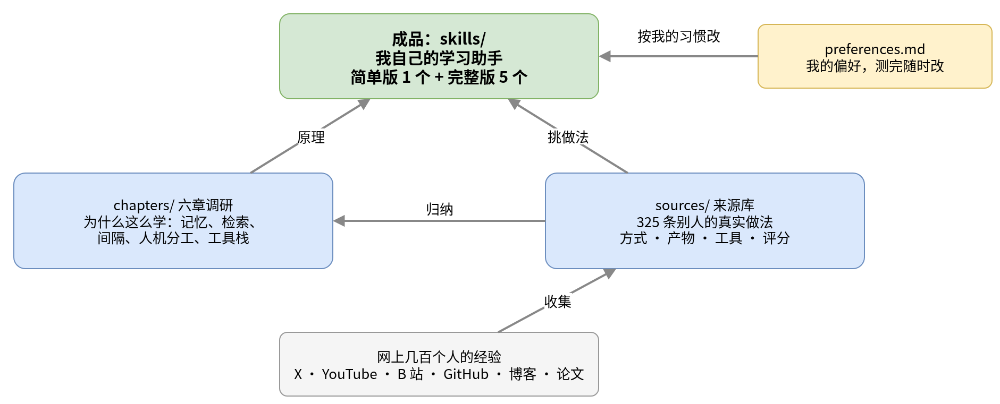

# AI 学习助手：我的学习 skills 和背后的调研

AI 时代想学的东西很多，资料和噪音更多。手上攒了一串不会的知识点，打开 AI 从早聊到晚，当天觉得懂了，过一周又想不起来；网上教人"用 AI 十倍速学习"的方法一大堆，每个都绑着不同的工具，看完反而更不知道从哪下手。

这个仓库是我给自己做的解决办法：一套**学习助手 skills**。给它一个主题，它要么直接交一份能从头读到尾的讲解，要么陪我从摸底开始一步步学，记下哪里还没懂，下次接着来。这套 skill 是读了几百个人分享的做法、对照学习科学的研究，再按我自己的习惯挑选和改出来的。仓库里除了 skill 本身，也留着这些调研，作为"为什么这么做"的依据。

## 仓库怎么组织



仓库分四块，从下往上看：

- **[sources/](sources/) 来源库**：最底层的原材料。325 条别人的真实做法，来自 X、YouTube、B 站、GitHub、博客和研究论文。每条写清他怎么做、留下什么产物、用什么工具、绑不绑定某个平台，并按"对搭学习流程有多大用"打了 1 到 5 分。低分的也留着。每条来源的原文也存了一份，放在 [sources/raw/](sources/raw/)：视频字幕全文、X 帖子全文和线程、网页和 GitHub 仓库的正文，方便以后自己或交给别的 agent 重新归纳。
- **[chapters/](chapters/) 六章调研**：在来源之上的讲解和归纳。讲记忆为什么会衰减，哪些学法有证据，人和 AI 怎么分工，工具怎么搭。
- **[preferences.md](preferences.md) 我的偏好**：从这些做法里我选了哪些、没选哪些。比如摸底要做但要随性，地图用 Draw.io，不做闪卡，不定时推送。
- **[skills/](skills/) 成品**：按偏好写成的学习 skills，拿去就能用。

前两块回答"别人怎么做、为什么有效"，后两块回答"我怎么做"。

## 成品：学习 skills

skills 分两个版本。

**简单版**只有一个 [learn-quick](skills/learn-quick/SKILL.md)。给它一个主题，比如"什么是 VPS 和线路"，它找资料核对事实，写一份由浅入深的 md 报告：一句话结论、背景、整体结构、逐个概念、行话速查表、怎么用上，需要时配一张 Draw.io 图，末尾附几道自测题。不摸底、不考试、不留进度，读完就完。

**完整版**有五个 skill，一起把一个主题真正学会，并留下记录：

| skill | 一句话 |
|---|---|
| [learn-probe](skills/learn-probe/SKILL.md) 摸底 | 像聊天一样抛出名词和小问题，我随便说（语音碎碎念也行），它听出我会到哪，定好起点 |
| [learn-map](skills/learn-map/SKILL.md) 画地图 | 把主题拆成 5 到 12 个节点的粗分层阶梯，用 Draw.io 画出来，卡住时往下补一层 |
| [learn-teach](skills/learn-teach/SKILL.md) 授课加小测 | 一次讲一个节点，写成 md 讲义，再轻轻考一两下，答错只记缺口不卡人 |
| [learn-track](skills/learn-track/SKILL.md) 记录进度和缺口 | 每个主题一个文件夹，四个 md：目标、地图、日志、缺口 |
| [learn-diagnose](skills/learn-diagnose/SKILL.md) 诊断误解 | 从日志和缺口里找出反复出现的同一个误解，补上缺的前置 |


想快速看懂一个东西，用简单版；想系统学、以后还要接着学，从摸底开始走完整版。速读报告读完想深入，也可以转完整版，报告当参考资料。每个 skill 什么时候用、它从哪些来源和哪几条偏好来，写在 [skills/README.md](skills/README.md)。

## 怎么装

所有 skill 都是标准的 `SKILL.md` 格式：开头一段 YAML 写名字和"什么时候用"，正文写步骤。它们不绑定任何工具，不需要 MCP，也不依赖 Notion、Obsidian 或某个特定的 agent 框架。

```bash
git clone https://github.com/aiyinyuedejustin/ai-learning-playbook.git
mkdir -p ~/.claude/skills ~/.agents/skills
cp -r ai-learning-playbook/skills/learn-* ~/.claude/skills/   # Claude Code，Cursor 也会读这里
cp -r ai-learning-playbook/skills/learn-* ~/.agents/skills/   # Codex
```

Grok Bot 让 bot 把这几个文件夹装进它的 skill 库就行。其他工具的位置见 [skills/README.md](skills/README.md#安装)。装好后，把 [preferences.md](preferences.md) 复制到学习仓库的根目录，skill 每次开始前都会读它。

两样外部能力会用到，但都不是必需的：

- **Draw.io**：画地图和配图。官方开源的 drawio skill 在 [jgraph/drawio-mcp](https://github.com/jgraph/drawio-mcp)；没装也行，skill 会直接写 `.drawio` 文件。
- **视频字幕**：AI 看不了视频，要先把字幕或语音转成带时间戳的文字。Grok Bot 上有现成的 `video-transcript-sources` skill。

## 背景调研：为什么这么学

skill 里的每个规定都有来头。想知道为什么，按下面顺序读六章调研，由浅入深：

**背景与框架**

1. [背景与动机：为什么"第一天学 8 小时"留不住](chapters/01-background.md)：记忆衰减、流畅感错觉，以及 AI 用对和用错的两项实验。
2. [整体框架：五个环节与人机分工](chapters/02-framework.md)：对齐、拆章、短课、检索、间隔复习；三种都叫 teach 的工具。

**细节**

3. [一次学习会话怎么安排](chapters/03-methods.md)：六条学习原则、60 分钟会话、第二天讲回、复习怎么排。
4. [工具栈：必备、可选和怎么串](chapters/04-stack.md)：最少三样、分层工具、学习流水线、学习类 skill 一览。
5. [大主题拆成章节，改写 skill 适配自己](chapters/05-chapters-and-adapting.md)：拆章工具、课程目录结构、怎么改 Matt Pocock 的 teach 和 anything-to-course。

**意义与启示**

6. [常见的失败方式和要点](chapters/06-takeaways.md)：七种失败方式、检查清单、十条要点、最短路径。

调研写的是"一般来说怎么学最有效"，会讲到间隔复习、闪卡、60 分钟会话这些做法；我的 skill 没有全部照搬，比如暂时不做闪卡、不按会话时长学。两者不一致的地方，是我按自己的情况做的取舍，理由写在 [skills/README.md](skills/README.md) 每个 skill 的"从哪来"里。

想看原始做法，去 [来源库](sources/)。[sources/README.md](sources/README.md) 有一份 19 个词的术语表（摸底、学习阶梯、掌握放行、检索练习……）和一张把这些词串起来的概念地图，再往下是全部 325 条来源的总表。

## 这套东西还会改

偏好是第一版，skill 也是第一版。我会拿真实的主题去试，哪里不顺手就先改 [preferences.md](preferences.md) 里对应的那一条，再让 skill 跟着改。调研和来源库是相对稳定的部分，有新的好做法再往 `sources/` 里补。

一句话：别人的经验放在 `sources/`，道理放在 `chapters/`，我的选择放在 `preferences.md`，能直接用的东西放在 `skills/`。

## 插图

插图都在 [figures/](figures/)。六章调研里的图用 HTML 画、headless Chrome 渲染，源文件和脚本 `gen.py` 在 `figures/src/`；仓库地图和 skills 配合图用 Draw.io 画，源文件 `repo-map.drawio`、`skills-flow.drawio` 和生成脚本 `drawio_gen.py` 也在 `figures/src/`，可以直接用 draw.io 打开修改。
