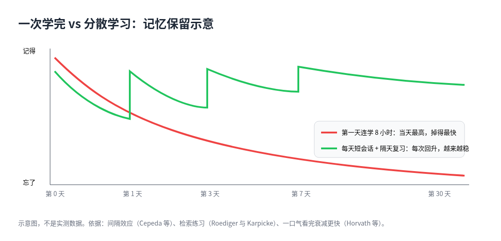

# 1. 背景与动机：为什么「第一天学 8 小时」留不住

## 一个常见的场景

碰到一个完全陌生的领域，最自然的做法是找个周末，打开 ChatGPT 或 Claude，从早聊到晚。AI 讲得清楚、有耐心、随问随答，一天下来感觉学了很多。可到了下周，能自己讲出来、做出来的东西往往所剩无几。热情过去，这件事也就放下了，也就是常说的三分钟热度。

问题不在 AI 讲得不好，而在于这种学法正好踩中了人类记忆的几个弱点。这一章先把这些弱点讲清楚，再看 AI 用对和用错时，研究里分别看到了什么。

## 记忆会衰减，而且「觉得会了」不可靠

学习科学里有一组反复被验证的结论，它们是后面所有做法的地基。

| 概念 | 主张 | 对用 AI 学习的含义 | 关键来源 |
| --- | --- | --- | --- |
| 间隔效应 | 同样的总时长，分散几次比一次塞满记得久 | 不要一口气学完；按 1 天、3 天、7 天、几周排再测 | Cepeda 等；Smolen 等，Nature Reviews Neuroscience |
| 检索练习 | 从记忆里想出来，比再读一遍有效 | AI 先逼你回答，再给反馈；不要先给完整答案 | Roediger 与 Karpicke；Dunlosky 等的综述 |
| 交错练习 | 相似主题混在一起练，更能分清彼此 | 后期会话混题；初期可以先按块学相似度低的技能 | Carvalho 与 Goldstone；Chen 等的系统综述 |
| 合意困难 | 练习时更吃力，之后记得更牢 | AI 讲得太流畅，会制造「学会了」的错觉 | Bjork；The Effortless Trap |
| 最近发展区 | 刚好差一点、有人搭把手，才跳得上去 | AI 要按你的水平动态加减提示，别一上来给全解 | Vygotsky；多篇 AI 脚手架实验 |
| 刻意练习 | 目标明确、重复、即时反馈、在舒适区外 | AI 当教练：一次只纠一个点，练习量留给你 | Ericsson；后续 AI 加技能训练的随机对照实验 |
| 流畅不等于存储 | 当下觉得会，不代表下周还会 | Matt 的 `teach` 和 Learn Anything Quickly 都强调存储强度 | Bjork；Matt Pocock 的 teach skill |

### 间隔到底该多长

Cepeda、Vul、Rohrer、Wixted、Pashler 在 Psychological Science 上发表的实验，覆盖一千三百多人。他们发现，最合适的复习间隔取决于**最终测验离现在有多远**：测验越远，最佳间隔越长，大约是目标保留时长的 5% 到 20%。

换成实际的话：只为明天考试，今天狂学、间隔很短也行；想三个月后还用得上，就要隔几天到几周再复习，而不是一天学 8 小时。一天连学 8 小时，等于间隔为零，正好落在曲线最差的位置。

链接：<https://journals.sagepub.com/doi/10.1111/j.1467-9280.2008.02209.x>

Smolen 等人在 Nature Reviews Neuroscience 上的综述从神经机制上解释了为什么分散学习更有效：<https://www.nature.com/articles/nrn.2015.18>

### 哪些学习方法真的有用

Dunlosky 等人比较了十种常见的学习方法。只有「练习测验」和「分散练习」被评为高效用；大家最常用的重读和划线，都是低效用。

- 原文：<https://www.psychologicalscience.org/publications/journals/pspi/learning-techniques.html>
- Scientific American 的介绍：<https://www.scientificamerican.com/article/what-works-what-doesn-t/>

Roediger 和 Karpicke 的实验更直观：学完 5 分钟后，重读组表现更好，看起来重读赢了；但两天和一周后，做过测验的那组完胜。当天的自我感觉会骗人，第二天才见分晓。

《Make It Stick》这本书把这些研究讲给普通读者，是入门的好选择：<https://www.hup.harvard.edu/books/9780674419377>

### 一口气看完的代价

Horvath 等人在 First Monday 上比较了连续追剧和按天、按周观看。一口气看完的人当天记得最多，但之后**衰减更快**，而且自评的享受程度反而更低。「当天爽」不等于「以后还在」。

链接：<https://firstmonday.org/ojs/index.php/fm/article/view/7729>

### 流畅感是怎么骗人的

Bjork 把记忆分成两件事：「当下能不能想起来」（提取强度）和「存得牢不牢」（存储强度）。读一段清楚的讲解，前者很高，后者几乎没动。

论文 The Effortless Trap 专门讨论 AI 怎么削弱合意困难：流利的讲解把本该自己挣扎的部分去掉了，于是产生能力错觉。一天刷 8 小时 AI 讲解，就是高流畅、低存储的典型。

链接：<https://arxiv.org/pdf/2606.26181.pdf>

AI 讲解恰好最擅长制造流畅感。它把原本需要你自己费力想的部分都替你想好了，于是当下的理解很顺，存进长期记忆的却很少。

## AI 用对和用错，结果可以相反

两项研究经常被放在一起讨论：

| 研究 | 做法 | 结果 | 链接 |
| --- | --- | --- | --- |
| Bastani 等，PNAS，近千名高中生学数学 | 一组直接用 GPT-4，一组用只给提示、不给完整答案的 GPT Tutor | 直接用 GPT-4 的练习分提高约 48%，但拿走 AI 后考试比对照组低约 17%；带限制的 Tutor 组基本消除了这个损失 | [PNAS](https://www.pnas.org/doi/10.1073/pnas.2422633122) · [作者 PDF](https://hamsabastani.github.io/education_llm.pdf) |
| Kestin 等，Scientific Reports，哈佛物理课 | 按教学原则专门设计的 AI 辅导 | 学习增益的中位数是课堂主动学习的两倍以上，用时更短，动机更高；长期保持效果还在跟进研究 | [Harvard Gazette](https://news.harvard.edu/gazette/story/2025/10/what-if-ai-could-help-students-learn-not-just-do-assignments-for-them/) · [论文 PDF](http://nature.com/articles/s41598-025-97652-6.pdf) |

社区对这两项研究的解读基本一致：同一类模型，护栏和用法不同，结果可以相反。哈佛那项研究用的是**为教学设计的辅导机器人**；PNAS 那项研究里吃亏的一组，用法就**像普通 ChatGPT 一样直接给答案**。

X 上也有人把两类结果并列转发。例如 amussis_xyz 既转了哈佛的研究（<https://x.com/amussis_xyz/status/2106345100271833197>），也转了另一项「有 AI 导师不等于学到」的随机对照实验（<https://x.com/amussis_xyz/status/2107008632239935998>）；getjotit 总结过一项研究，结论是 45 天后用 ChatGPT 的那组更差（<https://x.com/getjotit/status/2100400161524482394>）；burkov 转发了 Nature 和哈佛的那项研究（<https://x.com/burkov/status/2104598517356339418>）。

这也是全书的出发点：**问题不在于用不用 AI，而在于让 AI 做哪部分、人自己做哪部分。**

## 反驳「第一天学爆」的证据汇总

| 证据 | 说了什么 | 对一次学完的打击 |
| --- | --- | --- |
| Horvath 等，一口气看完与记忆 | 当天记得多，之后衰减比按天、按周看更快，主观享受也更低 | 当天爽不等于以后还在 |
| Cepeda 等，最佳间隔 | 要长期保留，复习间隔应随保留期拉长；零间隔最差 | 连学 8 小时近似零间隔 |
| Roediger 与 Karpicke | 5 分钟后重读好看；两天、一周后测验组完胜 | 当天自评会骗人，次日才见真章 |
| Bastani 等，PNAS | 无护栏 GPT：练习加 48%，拿走 AI 后考试减 17%；有护栏几乎不伤 | 「AI 陪练很猛」可能是假进步 |
| The Effortless Trap | 流利讲解去掉有益的挣扎，产生能力错觉 | 一天 8 小时 AI 讲解是高流畅、低存储 |
| Scott Young | 必要的努力（检索、建模、练习）不能外包；别用模拟练习代替真实环境 | 陌生领域更忌只和 AI 聊、不碰真实材料 |
| 费曼学习法加 AI | 同一天讲回测的是短期记忆；隔天讲回才测巩固后的记忆；失败就换角度再教，再隔一夜 | 正确的节奏是跨夜，不是通宵 |

## 什么难可以省，什么难不能省

Scott Young 在《用 AI 学得更好的 22 条想法》里给出一个很好用的分界：学习里有「不必要的难」和「必要的难」。

- **不必要的难**：找资料、整理材料、出练习题、判分、排复习日程。这些花时间但不直接产生记忆，交给 AI 很合适。
- **必要的难**：自己回忆、自己建立心智模型、自己动手做、隔几天再想起来。这部分正是记忆形成的地方，Bjork 称之为「合意困难」。外包出去，等于把学习本身外包了。

他还强调「直接性」：别用模拟练习代替真实环境。学一门语言就要真的去说，学一个框架就要真的写代码。陌生领域尤其忌讳只和 AI 聊、从不碰真实材料。

- 22 条想法：<https://www.scotthyoung.com/blog/2025/05/13/22-thoughts-on-using-ai-to-learn-better/>
- 他在另一篇文章里讲 Ultralearning（超级学习）怎么结合 AI：先用 AI 的深度研究功能画出技能树、找出专家的学习路径，再进入真正的练习。这解决了陌生领域「不知道从哪学起」的问题。<https://www.scotthyoung.com/blog/2026/04/29/ultralearning-ai/>

## 一句话结论

**AI 最适合砍掉不必要的难（找资料、生成练习、给反馈、排日程），绝不能砍掉必要的难（检索、间隔、交错、费力地解释）。**

第一天灌 8 小时只抬高了短期的流畅感，长期留存靠的是短会话、第二天讲回和间隔复习。一条可行的链路是：

> 定任务 → 画学习地图 → 分章上课 → 当天测验 → 第二天讲回 → 做卡进 Anki → 真题或真项目 → 拿到社区反馈

## 本书怎么读

- 第 2 章给出整体框架：五个环节、人和 AI 的分工，以及几种都叫 teach 却目标不同的工具。
- 第 3 章讲具体方法：各种学习协议、一次会话怎么安排、第二天怎么讲回、复习怎么排。
- 第 4 章讲工具和社区的实际做法：必备的几样、可选的几样，怎么串成一条流水线，以及学习类 skill 和项目的逐个说明。
- 第 5 章讲大主题怎么拆成章节、学习目录怎么组织，以及怎么改写现成的 skill 适配自己。
- 第 6 章收束：七种常见的失败方式、各平台的风气、检查清单和要点。
