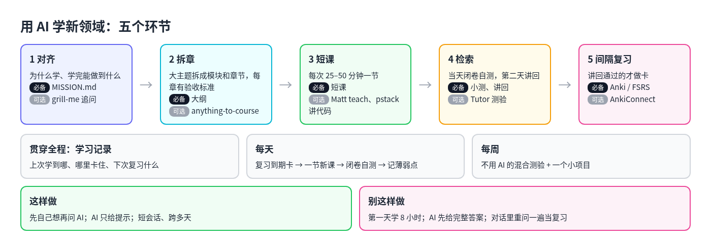
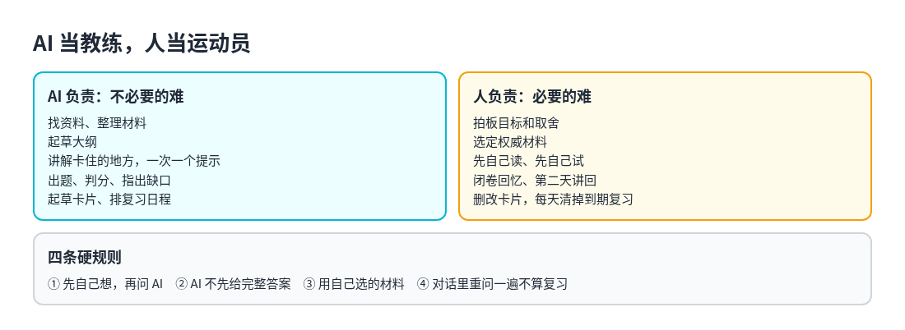
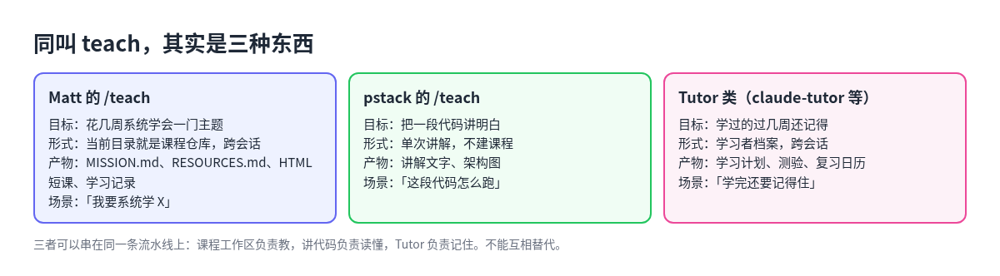

# 2. 整体框架：五个环节与人机分工

## 五个环节

把各种做法放在一起看，一套能坚持下去的「用 AI 学新领域」流程，大致都由五个环节组成：

| 环节 | 回答什么问题 | 典型产物 |
| --- | --- | --- |
| 1. 对齐 | 为什么学，学完能做到什么 | `MISSION.md`：目标、成功标准、每周投入时间 |
| 2. 拆章 | 这么大的范围先学什么、后学什么 | 大纲：模块、先后依赖、每章的验收标准 |
| 3. 短课 | 这一次学什么 | 25–50 分钟能学完的一节课，代码类内容配讲解 |
| 4. 检索 | 真的会了吗 | 当天小测、第二天闭卷讲回 |
| 5. 间隔复习 | 下个月还记得吗 | Anki 或其他间隔复习工具里的卡片和日程 |

前两个环节只在开始和每章结束时做，后三个环节每天循环。贯穿始终的是一份**学习记录**：上次学到哪、哪里卡住、下次该复习什么。有了它，每次打开 AI 不用从头解释背景。

## 人和 AI 怎么分工

社区里的说法几乎一致：AI 当教练，人当运动员。

| | AI 负责 | 人负责 |
| --- | --- | --- |
| 对齐 | 一轮轮追问，逼出模糊的地方 | 拍板目标和取舍 |
| 拆章 | 按材料起草大纲、标出前置知识 | 选定一两份权威材料，确认大纲 |
| 短课 | 讲解难点、换个角度、举例子 | 先自己读、先自己试 |
| 检索 | 出题、判分、指出缺口 | 先闭卷回答，再看反馈 |
| 复习 | 起草卡片、排日程 | 删改卡片，每天清掉到期的复习 |

几条硬规则贯穿全部环节：

1. **先自己想，再问 AI。** 默写、做题、讲解都先关掉 AI 做一遍。
2. **AI 只给提示，不先给完整答案。** 这是 Bastani 实验里 Tutor 组没有吃亏的关键。
3. **用自己选的材料，不靠模型记忆。** 把课件、论文、文档交给 AI，要求它只依据这些回答。
4. **对话里重问一遍不算复习。** 间隔复习要交给专门的工具去排。

## 同叫 teach，其实是三种东西

在 agent skill 的生态里，「teach」「tutor」「learn」这些名字被反复使用，但它们的目标、过程和产物差别很大，混用容易失望。

| | Matt Pocock 的 `/teach` | pstack 的 `/teach` | Tutor 类（如 claude-tutor） |
| --- | --- | --- | --- |
| 目标 | 花几周系统学会一门主题 | 把一段代码、一个子系统讲明白 | 学过的东西过几周还记得 |
| 过程 | 先写目标，找可信资料，按「稍难但能做到」的程度出短课 | 先查代码怎么跑、为什么这样设计，再用大白话讲 | 计划 → 讲 → 测验 → 按算法排复习 |
| 是否跨会话 | 是，当前目录就是一个课程仓库 | 否，单次讲解 | 是，有学习者档案 |
| 产物 | `MISSION.md`、`RESOURCES.md`、HTML 短课、学习记录 | 讲解文字和架构图 | 学习计划、测验、复习日历 |
| 什么时候用 | 「我要系统学 X 几周」 | 「这段调度代码怎么跑」 | 「学完还要记得住」 |

一句话：Matt 的是课程工作区，pstack 的是讲代码，Tutor 类管记忆。三者可以串在一条流水线上，但不能互相替代。

除了这三种，还有几类常见的工具，第 4 章会逐一展开：

- **知识吸收**：把长文、论文变成结构化笔记并配追问，如 Knowledge Absorber。
- **制卡**：把材料变成 Anki 卡片，如 anki-skill、learn-skill。
- **对齐与对抗**：开学前追问到范围清楚，学完找盲点，如 Matt 的 `grill-me`、pstack 的 `interrogate`。

## 一天和一周的节奏

框架落到日程上，大致是这样：

- **每天 25–50 分钟**：先清到期的复习，再学一小节新内容，然后闭卷自测，记下薄弱点。
- **第二天**：不看材料，把昨天的内容讲回给 AI 听，让它按评分标准判通过与否。通过的才做成卡片。
- **每周一次**：混合几章的题做一次不用 AI 的测验；做一个小项目或真题，检验能不能用在真实场景里。

细节在下一章。
