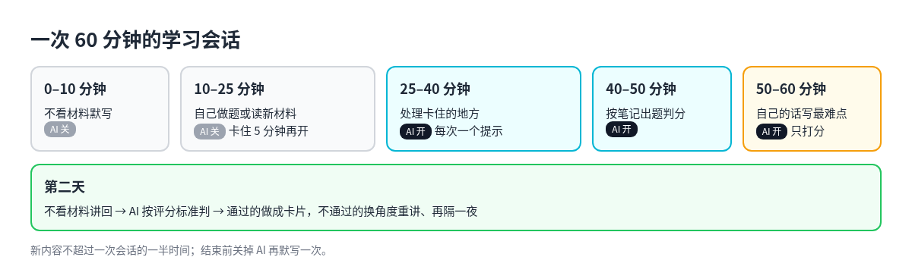

# 3. 细节一：一次学习会话怎么安排

这一章把框架里每天循环的三个环节，短课、检索、间隔复习，落到具体做法上。

## 背后的六条学习原则

| 原则 | 意思 | 对 AI 用法的要求 |
| --- | --- | --- |
| 间隔 | 同样时长，分散几次比一次学完记得久 | 不要一天学完；按 1 天、3 天、7 天、几周排复习 |
| 检索 | 从记忆里想出来比重读有效 | AI 先提问，你先答，再给反馈 |
| 交错 | 相似内容混在一起练，更能分清彼此 | 学到中后期，让 AI 出跨章节混合题 |
| 合意困难 | 练的时候吃力一点，之后记得更牢 | 别让 AI 把每一步都讲顺 |
| 最近发展区 | 稍难一点、有人搭把手，才学得最快 | AI 按你的水平加减提示，不一上来给完整解 |
| 刻意练习 | 目标明确、即时反馈、反复做 | AI 一次只纠正一个问题，练习量留给你 |

## 一次 60 分钟的会话

下面这个安排综合了 Timtis、Dafi 等几篇实测文章，适合大多数概念类和技能类内容。时间短的话可以等比例缩到 25–30 分钟。

| 时间 | 做什么 | AI 开着吗 |
| --- | --- | --- |
| 0–10 分钟 | 不看材料，把这个主题记得的都写下来 | 关 |
| 10–25 分钟 | 自己做题或读新材料 | 关，卡住超过 5 分钟再开 |
| 25–40 分钟 | 处理卡住的地方 | 开，每次只要一个提示 |
| 40–50 分钟 | 让 AI 按你的笔记出题、判分 | 开 |
| 50–60 分钟 | 用自己的话写下今天最难的一点 | 开，只打分，不代写 |

有两个比例值得写进自己的规则里：

- 新内容最多占一次会话的 40–60%，其余时间给回忆、订正和混合练习。
- 会话结束前把 AI 关掉，再默写一次。

## 第二天讲回

当天的小测只能说明「刚才懂了」。真正检验有没有记住，要隔一夜。Learning Harness 上关于费曼学习法加 AI 的文章给了一个具体流程：

1. **第 0 天**：学一节课，做小测。
2. **睡一觉**。
3. **第 1 天**：不看材料，向 AI 讲解昨天的内容。AI 拿着原课文和一份评分标准，判通过或不通过。
4. 不通过的地方，换个角度重新讲，再隔一夜讲回。
5. 通过的概念才做成卡片，进入间隔复习。

最后一步很关键：把讲错的内容做成卡片，等于用间隔复习去巩固一个错误。

## 让 AI 当出题人和判卷人

几种角色可以分开设置提示词，各管一件事：

| 角色 | 做什么 | 注意 |
| --- | --- | --- |
| 导师 | 讲解、追问、给提示 | 你没尝试之前不给完整答案 |
| 出题 | 只从你给的材料出检索题，一次一题 | 错题记进薄弱点清单 |
| 判卷 | 第二天讲回时按评分标准判分 | 不替你把话说完 |
| 制卡 | 只给讲回通过的概念出卡 | 一张卡只考一件事 |

主流聊天产品都有内置的学习模式：ChatGPT 的 Study Mode、Claude 的 Learning 模式、Gemini 的 Guided Learning。Timtis 的对比是：ChatGPT 先摸你的水平，再分步检查；Claude 更爱追问、反驳你的假设，但感觉慢，容易被人关掉；Gemini 图和视频多，但容易滑向被动观看。无论用哪个，学习模式开着是第一道护栏。

## 间隔复习怎么排

- **AI 不是间隔复习系统。** Hacker News 上有人让 ChatGPT「像 Anki 一样考我」，回复里一针见血：它是语言模型，不是间隔复习系统。在同一个对话里偶尔再问一遍，不等于按遗忘曲线排日程。
- **用专门的工具。** Anki 加 FSRS 算法是最常见的组合，也有 Mochi、Obsidian 的间隔复习插件、自托管的 Engram 等。
- **AI 只起草卡片。** Anki 社区反复提醒：AI 生成的卡常常一张塞三四个知识点，违背「一张卡一件事」的原则；而且自己做卡本身就是思考。比较稳的顺序是：先学懂，AI 起草，人删改拆小，再导入。
- **按「还要用多久」调间隔。** 只为下周考试，间隔短一些；要长期用，间隔拉到几周。

## 一份可以照抄的学习规则

写进学习目录的 `NOTES.md`，让每次会话的 AI 都读到：

1. 我没尝试之前，不给完整答案，只给提示。
2. 每次会话新内容不超过一半时间。
3. 每个概念：当天小测，第二天讲回，通过才做卡。
4. 薄弱点按 1、3、7、14 天进入复习，或交给 FSRS。
5. 每周一次不用 AI 的混合测验，外加一个真实的小项目或真题。
