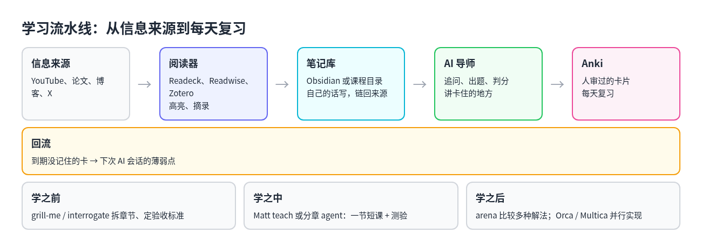

# 4. 细节二：工具栈，必备、可选和怎么串

## 最少需要三样

社区里能坚持三个月以上的人，工具大多不超过这三样：

1. **一个 AI 聊天**，学习模式开着。
2. **一个间隔复习工具**，几乎都是 Anki。
3. **一个放材料的地方**，哪怕只是一个文件夹加几个 Markdown 文件，常见的升级是 Obsidian。

少了第二样，三分钟热度的风险最高；少了第三样，每次对话都要从零交代背景，没法跨会话积累。

## 按层看工具

按学习流水线分层，而不是按品牌：

| 层 | 是否必需 | 干什么 | 常见选择 |
| --- | --- | --- | --- |
| 阅读与收集 | 强烈推荐 | 存文章、论文、视频字幕，做高亮 | Readwise Reader、自托管的 Readeck、Zotero（论文） |
| 笔记库 | 强烈推荐（跨周学习时） | 用自己的话写笔记、建立链接、记录进度 | Obsidian、Logseq、一个课程目录 |
| AI 导师 | 必需 | 讲解、追问、出题、判分 | ChatGPT Study Mode、Claude Learning、Gemini Guided Learning；本机编码 agent 的讲解类 skill |
| 间隔复习 | 必需 | 排复习日程，对抗遗忘 | Anki（配 AnkiConnect）、Mochi、Obsidian 间隔复习插件、Engram |
| 制卡桥 | 可选，量大后接近必需 | 把高亮和笔记变成卡片草稿 | Readwise 的 Ghostreader、Anki MCP、n8n 流水线、制卡类 skill |
| Agent 编排 | 可选 | 拆章节、并行查资料、对抗评审 | Matt 的 `teach` 与 `grill-me`；pstack 的 `arena`、`interrogate`；Multica、Orca（偏执行） |
| 外设 | 可选 | 降低输入摩擦 | 文档相机、语音模式、手写板 |

## 怎么串起来



```text
[信息来源] YouTube / 论文 / 博客 / X
     │ 稍后读、下载字幕
     ▼
[阅读器] Readeck / Readwise / Zotero
     │ 高亮、摘录，可选 AI 起草卡片
     ▼
[笔记库] Obsidian 或课程目录
     │ 用自己的话写笔记，链回来源
     ├──► [AI 导师] 追问、出题、判分、讲卡住的地方
     │          │
     │          ▼ 人审过的卡片
     └──► [Anki] 每天复习
                │
                └─ 到期没记住的卡，回到下次 AI 会话当薄弱点
```

Agent 编排工具插在三个位置：

- **学之前**：用 `grill-me` 或 `interrogate` 把大范围拆成章节和验收标准。
- **学之中**：用 Matt 的 `teach` 或分章的 agent，每章一节短课加测验。
- **学之后**：用 `arena` 对同一练习比较多种解法；或者用 Orca、Multica 把已经理解的设计并行实现出来。

## 社区里几条值得照搬的做法

**纸笔做题，AI 批改。** Noah Tye 在纸上做题，用文档相机拍下来交给 ChatGPT，让它区分抄错、算错和概念错。这条推文传播很广，原因很简单：它强制人先产出，AI 只负责批改，正好符合 Bastani 实验里「只给提示」的思路。

**苏格拉底式辅导加 Anki。** Hacker News 和 Reddit 上的常见组合：AI 用追问的方式辅导，再起草卡片，导入真正的间隔复习工具。可以加 MCP 或 AnkiConnect，让对话里冒出来的难点直接变成卡片。相关的工具有 Janus（把 PDF、视频、笔记转成 Anki 或 Mochi 卡片）和 Keepmind。

**Readwise 到 Anki 的流水线。** Readwise Reader 里的 Ghostreader 起草卡片，通过 Obsidian 插件同步到 Anki；也有人用 n8n 加 GPT 加 AnkiConnect 全自动跑。评论区的提醒是：全自动容易让卡片质量崩掉，中间要有一步「这条值不值得记」的人工筛选。

**用 AI 维护笔记库。** 一种做法是让 AI 给一本难书生成「掌握套件」：全书地图、笔记骨架、回忆题、卡片和日程，但读和写仍然由人来做。另一种是 Karpathy 式的 LLM Wiki：原始材料放在 `raw/` 不动，AI 维护 `wiki/` 里的链接页面。

## 学习相关的 skill 和项目

按产出分类，链接见 [来源](../sources.md)。

| 类别 | 项目 | 做什么 |
| --- | --- | --- |
| 课程工作区 | [mattpocock/skills](https://github.com/mattpocock/skills) 的 `teach` | 当前目录变成课程，写目标、找资料、出 HTML 短课、记学习记录 |
| 课程工作区 | [koganei/learn-anything-skill](https://github.com/koganei/learn-anything-skill) | 自动查资料，按基础、进阶、高级、应用分章 |
| 讲代码 | [backnotprop/pstack](https://github.com/backnotprop/pstack) 的 `how` / `why` / `teach` / `bro` | 讲清代码怎么跑、为什么这样设计，或用大白话重说 |
| 讲代码 | [sbkriz/feynman-tutor](https://github.com/sbkriz/feynman-tutor) | 你来讲，AI 追问缺口 |
| 辅导闭环 | [kirilxd/claude-tutor](https://github.com/kirilxd/claude-tutor) | 计划、讲解、测验、SM-2 排复习，带网页面板 |
| 辅导闭环 | [mordor-forge/study-skill](https://github.com/mordor-forge/study-skill) | 交互学习加 FSRS |
| 辅导闭环 | [Bhala-Srinivash/agent-tutor-skill](https://github.com/Bhala-Srinivash/agent-tutor-skill) | 讲解、举例、检查、练习，FSRS 排复习，可绑定 PDF 或代码当教材 |
| 制卡 | [doasfrancisco/anki-skill](https://github.com/doasfrancisco/anki-skill) | 写代码时提议卡片，你批准后写入 Anki |
| 制卡 | [HumphreySun98/Smart-Study-Agent](https://github.com/HumphreySun98/Smart-Study-Agent) | 概念图、FSRS、导出 Anki 牌组 |
| 制卡 | [guepardlover77/learn-skill](https://github.com/guepardlover77/learn-skill) | 材料变学习计划，生成 `.apkg` 和 Obsidian 笔记 |
| 知识吸收 | [YuJunZhiXue/StudyAnalysis-Skills](https://github.com/YuJunZhiXue/StudyAnalysis-Skills)（Knowledge Absorber） | 长文变 Markdown 和 HTML 结构化笔记，带导师追问 |
| 知识吸收 | [huifer/Claude-Code-KnowCraft](https://github.com/huifer/Claude-Code-KnowCraft) | 本地知识库加 SM-2 加费曼式追问 |
| 对齐与对抗 | Matt 的 `grill-me`；pstack 的 `interrogate`、`arena`、`swarm` | 追问到范围清楚；多角度找盲点；多方案比较 |
| 给 agent 自己记 | [cheanus/SRSA](https://github.com/cheanus/SRSA) | 让 agent 自己做间隔复习，不是给人背 |

linux.do 的学习 skill 征集帖里，被推荐最多的是 Matt 的 `teach` 和 Knowledge Absorber。

## 什么时候再加可选项

| 工具 | 值得加的时机 |
| --- | --- |
| Obsidian 和 Anki 同步插件 | 笔记里已经在写问答对，不想两边维护 |
| n8n 等自动化 | 每天的高亮量超过手动审卡的能力，而且愿意维护流水线 |
| Zotero | 主要读论文 |
| Matt 的 `teach` | 一门主题要学几周 |
| Knowledge Absorber | 经常要啃长 PDF |
| SRSA | 想强化的是 agent 的记忆 |
| Multica、Orca | 学完要把东西做出来，交给多个 agent 并行实现 |
| 全本地模型 | 有隐私或离线的硬需求；否则复杂度通常大于收益 |

Reddit r/ollama 上有人问自己是不是被工具复杂度骗了，回复的建议很实在：先只做读、问、提建议，要写回笔记库时先试跑一遍。
