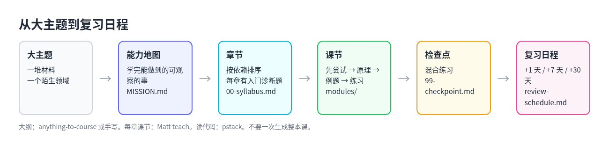

# 5. 细节三：大主题拆成章节，改写 skill 适配自己

## 从大主题到每天的一节课

一个陌生领域范围很大，直接让 AI「教我 X」，要么讲得太浅，要么一次生成几十节课，看着完整，其实很多是凭空编的。比较稳的做法是一层层往下拆：



```text
大主题或一堆材料
  → 能力地图：学完能做到哪些可观察的事
  → 模块和章节：按依赖排序，每章有入门诊断题
  → 课节：先尝试，再讲原理，再练习
  → 检查点：混合练习
  → 复习日程
```

## 现成的拆章工具

**[lowwwbank/anything-to-course](https://github.com/lowwwbank/anything-to-course)** 是这类工具里设计最完整的一个，适合拿来改：

| 阶段 | 做什么 | 产物 |
| --- | --- | --- |
| 能力地图 | 把材料压成可观察的能力、缺口和前置知识 | 并入大纲 |
| 建课 | 按模块拆课，答案和练习放在不同目录 | `00-syllabus.md`、`modules/NN-*/`、`answers/` |
| 学习模式 | 先做后看答案，AI 当导师 | `review-schedule.md`（+1 天、+7 天、+30 天） |

它的每节课固定一个顺序：先尝试，再讲原理，然后看例题、对比反例，接着练习（提示逐渐减少），最后检查点。这个顺序本身就是把学习科学写死在模板里。

最值得改的是它的三个参考文件：`references/course-blueprint.md`（课程蓝图）、`practice-design.md`（练习设计）和 `study-mode.md`（学习模式）。fork 之后改这几个模板，就能适配自己的领域。

**Matt 的 `teach`** 不一次生成整本大纲，而是：

1. 用 `MISSION.md` 钉住为什么学。
2. 按你当前的水平，每次只出一节 `lessons/000N-….html`。
3. 用 `learning-records/` 记下每次的发现，决定下一节学什么。

大范围时可以这样配合：先用 anything-to-course 或自己写出模块地图，再让 Matt 的 `teach` 每次只负责其中一章。

这样可以避免一次生成四十节课，其中不少是凭空编的。

**Tutor 类**也有拆章的味道：

- claude-tutor：`/learn <主题>` 生成带资料的学习计划，有章节感 → `/quiz` 测验 → `/review` 复习。
- agent-tutor-skill：按概念记录掌握程度，用 FSRS 排复习；可以把 PDF、网址或代码绑定为教材。
- learn-anything-skill：直接给出编号路径，01–05 是基础，06–09 是进阶，10–11 是高级，12–17 是应用场景。

## 社区里的拆章模板

把几篇帖子的做法合起来，一个可复用的流程是：

1. **定范围**：人写一句话目标加截止日期；AI 输出章节大纲，每章都必须可以验收。
2. **追问**：用 `grill-me` 或 `interrogate` 逼出假设和盲点，修改大纲。
3. **每章一个小工作区**（Matt `teach` 的风格）：`MISSION.md`、资料、课节 HTML、学习记录。
4. **每章结束交出三样东西**：
   - 5–15 张人审过的 Anki 卡；
   - 一页用自己的话写的总结，可以放进 Obsidian；
   - 3 道关掉 AI 也能做的练习。
5. **每天 Anki**；每周只针对「又忘了的卡」让 AI 再讲一遍。
6. **落成项目**（可选）：用编码 agent 把这一章做成能跑的小 demo。这才是和 AI 协作，而不只是陪聊。

## 推荐的组合

| 步骤 | 用什么 | 产出 | 是否必备 |
| --- | --- | --- | --- |
| 1. 定目标和成功标准 | Matt 的 `grill-me`，或手写 | 学完能做什么的清单 | 必备 |
| 2. 拆大纲 | anything-to-course，或手写大纲 | `00-syllabus.md` 和模块顺序 | 必备 |
| 3. 按章上课 | Matt 的 `teach` 或 anything-to-course 的课节 | 课节文件 | 必备 |
| 4. 读代码时讲清楚 | pstack 的 `how`、`why`、`teach` | 对代码的理解 | 学代码时必备 |
| 5. 啃长文和论文 | Knowledge Absorber | 结构化笔记 | 材料多时必备 |
| 6. 检验是不是真懂 | Tutor 的测验，或 pstack 的 `interrogate` | 测验结果、盲点清单 | 必备 |
| 7. 对抗遗忘 | FSRS 或 SM-2 类 Tutor，或 Anki skill | 复习队列 | 跨周学习时必备 |
| 8. 沉淀到个人知识库 | KnowCraft、Obsidian | 可检索的笔记 | 可选 |
| 9. 让 agent 自己记住规矩 | SRSA，或 pstack 的 `reflect` | agent 的记忆卡、改过的 skill | 可选 |

## 一门课一个目录

```text
learn-<主题>/
├── MISSION.md             # 为什么学、2–5 条可观察的成功标准、每周时间上限
├── RESOURCES.md           # 选定的权威材料，标注读过没有
├── NOTES.md               # 学习规则：AI 不先给答案、新内容占比上限等
├── 00-syllabus.md         # 模块地图、先后依赖、预计周数
├── modules/
│   ├── 01-基础/
│   │   ├── 00-overview.md # 本章产出、前置知识、入门诊断题
│   │   ├── 01-lesson.md   # 或 HTML 短课
│   │   └── 99-checkpoint.md
│   └── 02-…
├── answers/               # 和练习分开放
├── weak-items.md          # 每天的薄弱点，喂给复习
├── review-schedule.md     # +1 天 / +7 天 / +30 天，或 FSRS 导出
├── learning-records/      # 每学完一章写一条不显然的发现
└── progress.md            # 上次学到哪、下次建议什么时候复习
```

也可以加上这些目录：`curriculum/00-map.md` 放 80/20 地图和章节树，`reference/` 放术语表、公式、API 速查，`crystals/` 放 Knowledge Absorber 生成的结构化笔记。同一个结构也可以直接当 Obsidian 库用。

两个提醒：这个目录要和日常写代码的仓库分开，否则课程文件会混进代码里；Anki 牌组可以命名为 `learn-<主题>`，卡片里加一个 `Source:: [[笔记名]]` 字段指回对应的笔记。

## 改写现成的 skill

现成的 skill 是别人按自己的习惯写的，直接用常常不太顺手。改写的原则：

1. **复制一份再改**。用 `npx skills add` 装进项目，或者 fork 仓库，不要直接改插件市场里装的只读版本。
2. **只改三处**：触发描述、产物放在哪里、领域术语表。
3. **骨架不动**：先做后看、检索、间隔这些是它比「让 AI 讲课」强的地方，删了就退化成普通聊天。
4. **一门课一个目录**：讲代码的 skill 放在全局，课程类 skill 的状态留在各自的课程目录里，不要搅在一起。

### 改 Matt 的 `teach`

- 在 `MISSION.md` 的格式里加上自己的成功标准字段，比如「能讲清楚 Builder 和 Target 怎么分工」「能独立跑通一次评测」。
- 在 `NOTES.md` 里固定偏好：每天最多几节新课、是否必须附原文链接、用中文还是英文。
- 测验组件可以复用，示意图换成自己领域的。

### 改 anything-to-course

- `course-blueprint.md`：模块命名换成自己的领域，比如 `01-harness-concepts`。
- `practice-design.md`：练习题型换成领域里真正会做的事，比如「改一段 adapter」「解释一份执行记录」。
- `study-mode.md`：导师会话时长改成 25–40 分钟，到点强制结束去复习。

### 改 Tutor 类和制卡工具

- claude-tutor 或 agent-tutor-skill：把每天新课的上限写进配置或 `NOTES.md`，例如每天一节新课加复习旧卡。
- Knowledge Absorber 接 Anki：先出结构化笔记，再用 anki-skill 或 learn-skill 抽出原子卡。

### 按场景挑

| 场景 | 改哪个 | 怎么改 |
| --- | --- | --- |
| 系统学一套评测框架 | Matt 的 `teach` 加 anything-to-course | 目标写成「能独立复现某个评测流程」；大纲按概念、环境、跑通、改 skill、评测分模块 |
| 读陌生代码 | pstack | 基本不用改；大的子系统用 `teach`，细节用 `how` |
| 论文变成可复习的卡片 | Knowledge Absorber 接 Anki | 先出结构化笔记，再用 anki-skill 或 learn-skill 拆出一张一事的卡片 |
| 方案对齐 | `grill-me`、`interrogate` | 先追问定范围，再找盲点，最后交给 Multica 或 Orca 执行 |
| 防止三分钟热度 | FSRS 类 Tutor 加复习日程 | 在 `NOTES.md` 写死每天的新课上限 |

## 按顺序补齐

如果已经装了 pstack（讲代码这一层已经齐了），可以按这个顺序补：

1. **大纲层**：fork 或安装 [anything-to-course](https://github.com/lowwwbank/anything-to-course)，模板最适合改。
2. **课程层**：装 Matt 的 [`teach`](https://github.com/mattpocock/skills)，放在单独的学习目录。
3. **记忆层**：二选一，[claude-tutor](https://github.com/kirilxd/claude-tutor) 的闭环最完整，[agent-tutor-skill](https://github.com/Bhala-Srinivash/agent-tutor-skill) 用的 FSRS 更新。
4. **材料吸收**（可选，论文多时很值）：[Knowledge Absorber](https://github.com/YuJunZhiXue/StudyAnalysis-Skills)。
5. **制卡**（可选）：已经在用 Anki 的话，加 [anki-skill](https://github.com/doasfrancisco/anki-skill)。

串起来就是：`grill-me` 写 MISSION → anything-to-course 出大纲 → 每章用 Matt 的 `teach` 或 anything-to-course 的课节 → 读代码时用 pstack 的 `teach` → 当天 `/quiz` → 按 FSRS 或 Anki 隔天回看。

## 和 AI 一起学，而不是让 AI 替你学

所谓协作共赢，落到分工上就是：AI 负责出题、判卷、读材料、排日程，这些重复又耗时的活；你负责回忆、讲解、动手，这些只有自己做才算数的活。

并行的 agent 适合用来查资料、比较不同来源、起草练习题。但最后的检索和讲回，必须是你本人。学到一定程度后，用编码 agent 把一章内容做成能跑的小项目，才是真正的收获，而不是陪聊。
