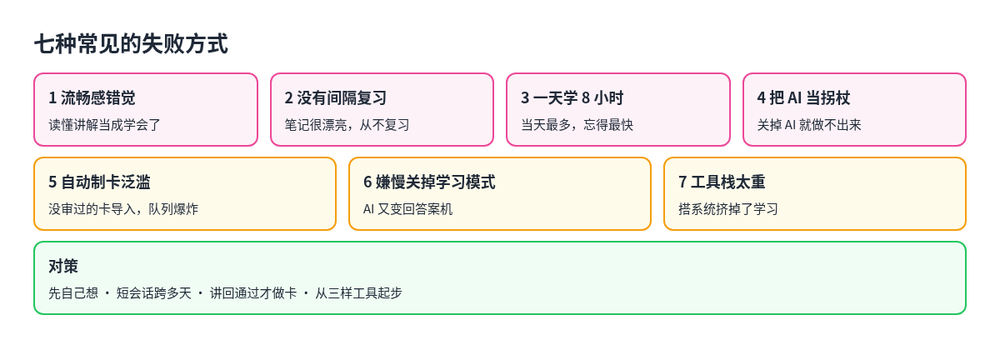

# 6. 意义与启示：常见的失败方式和要点

## 七种常见的失败方式

社区帖子和研究里反复被点名的坑：

**1. 流畅感错觉。** 读完 AI 清楚的讲解，当下觉得懂了，第二天早上什么都不剩。Timtis 的实测里，「粘贴题目、抄答案」式的会话感觉最高效，隔天几乎没留下什么（<https://www.timtis.com/blog/how-to-use-ai-to-study-without-skipping-the-actual-learning/>）。

**2. 没有间隔复习的学习系统。** 只建 Obsidian 图谱，不排复习；或者只是让 ChatGPT 再问一遍。第一周很猛，第三周笔记和牌组都堆着不再打开。Notesmakr 说得直白：漂亮的知识图谱不等于记住，没有间隔复习，第二大脑只是一台精美的重读机器（<https://notesmakr.com/blog/how-to-use-obsidian-for-studying>）。

**3. 一天学 8 小时。** 违反间隔效应。Dunlosky 的综述说得很清楚：突击在当场占优，一周后输掉。健康的节奏是短会话、跨多天，每天清掉 Anki 里到期的卡。

**4. 把 AI 当拐杖。** Bastani 的实验把这叫作拐杖效应：练习时有 AI，分数很高；考试或独立做任务时，比从来没用过 AI 的人还差（<https://www.pnas.org/doi/10.1073/pnas.2422633122>）。Timtis 列了几个警告信号：
- 关掉对话就做不出同类题
- 会话结束只有整洁的答案，没有自己的草稿
- 每次都从粘贴题目开始
- 笔记全是没读过的材料的 AI 摘要
- 考前信心爆棚，考场一片空白

**5. 自动制卡泛滥。** 批量导入没审过的 AI 卡片，复习队列爆炸，最后放弃。Anki 社区的说法是：宁少勿滥，一张卡一件事，人必须过目（<https://www.reddit.com/r/Anki/comments/1bncpwy/to_the_people_who_used_chatgpt_to_create_cards/>）。

**6. 一嫌慢就关掉学习模式。** 学习模式感觉慢，切回普通对话，AI 又变回答案机。护栏靠的是自觉，不是功能开关。

**7. 工具栈太重。** Obsidian 加十几个插件、n8n、本地模型、双向同步，搭系统本身变成了项目，要学的东西反而被挤掉。同时开三个笔记软件、两个复习工具，或者第一天装 20 个 skill 却没定任何验收标准，都属于这一类。r/ollama 上那个「是不是被工具复杂度骗了」的帖子就是例子（<https://www.reddit.com/r/ollama/comments/1sv9bqr/am_i_building_a_feasible_localfirst_ai_study/>）。

### 看着很全、其实注定失败的工具组合

- 同时开三个笔记软件、两个复习工具，全自动制卡且不审；
- 只有第二大脑，没有每天的 Anki；
- 只有 ChatGPT，没有材料库，也没有间隔复习；
- 第一天装 20 个 skill，零个章节验收标准；
- 只装一个叫 teach 的 skill，指望它既讲代码、又管 Anki、又拆大纲；
- 在日常写代码的仓库根目录里跑 Matt 的 `teach`，课程文件混进代码；
- 让一群 agent 批量「替你学」：学习闭环需要你本人做检索练习。

## 各平台的风气

不同平台的讨论风格不一样，读的时候心里要有数。点赞数在不同平台之间不可比（Reddit 的分数、X 的点赞、linux.do 的回复数是不同的尺度），所以本书挑选做法时，更看重能不能复现，而不是哪条最火。

| 平台 | 风气 | 代表链接 |
| --- | --- | --- |
| Reddit r/Anki | 对卡片质量很讲究；AI 起草可以，乱导不行 | [制卡效率](https://www.reddit.com/r/Anki/comments/1hov0v9/what_is_the_most_efficient_and_fast_way_to_make/) · [AI 制卡的问题](https://www.reddit.com/r/Anki/comments/1bncpwy/to_the_people_who_used_chatgpt_to_create_cards/) |
| Reddit r/ObsidianMD、r/PKMS | Obsidian 当源头，Anki 当复习引擎，单向同步 | [Obsidian 加 Anki](https://www.reddit.com/r/ObsidianMD/comments/1vzic42/anyone_using_obsidian_anki_together_for_spaced/) · [在 Obsidian 里用 GPT](https://www.reddit.com/r/PKMS/comments/1nj4b22/how_ive_been_using_gpt_in_obsidian_to_actually/) |
| Hacker News | 对间隔复习原理很较真；Show HN 的工具多 | [Janus](https://news.ycombinator.com/item?id=46599896) · [模型不是间隔复习系统](https://news.ycombinator.com/item?id=44021924) |
| linux.do | skill 和 MCP 的实战多；常推 Matt `teach`、Knowledge Absorber、Anki MCP | [学习 skill 征集](https://linux.do/t/topic/2761043) · [Anki MCP](https://linux.do/t/topic/1510992) |
| X | 个人工作流爆款和产品软广混在一起；值得挑「纸笔加反馈」这类 | [Noah Tye](https://x.com/noahlt/status/2108675665373589841) · [哈佛研究的传播](https://x.com/burkov/status/2104598517356339418) |
| YouTube | 入门教程多，成体系的少；适合当入口，再回到文字材料 | [用 ChatGPT 学习的入门视频](https://www.youtube.com/watch?v=qrUImmmxrvg) |

## 每样工具在流水线里的位置

| 工具 | 在流水线中的位置 |
| --- | --- |
| pstack 的 `teach`、`how`、`why`、`bro` | AI 导师层：代码的即时讲解，不是跨周的课程 |
| pstack 的 `interrogate`、`arena` | 编排层：找盲点、比较多个方案 |
| Matt 的 `/teach` | 笔记库加 AI 导师：跨会话的课程工作区 |
| Matt 的 `grill-me` | 编排层：和人对齐大纲 |
| Knowledge Absorber | 从阅读到笔记：长文变结构化笔记 |
| Anki 加 MCP | 间隔复习和制卡桥 |
| Multica Squad、Orca | 编排层的执行一侧：学完后的实现和派活，不是记忆层 |

## 一份防三分钟热度的检查清单

**每天**（5–20 分钟也行）
- [ ] 清掉到期的复习，或写下跳过的原因
- [ ] 至少有一段关掉 AI 默写或做题

**每学完一章**
- [ ] 有验收标准：能解释、能做题，或能教别人
- [ ] 新卡不超过 20 张，而且都人工删改过
- [ ] 来源记在笔记里，能找回原文

**每周**
- [ ] 把又忘了的卡片挑出来，只针对这些开 AI 补讲
- [ ] 删掉一个不再用的工具或插件

**每月**
- [ ] 一次不用 AI 的综合测验，题目跨章节、换个情境

## 十条要点

1. AI 省掉不必要的难（找资料、出题、判分、排日程），必要的难（回忆、讲解、动手、隔天再想起来）留给自己。
2. 记忆会衰减，流畅感会骗人。当天觉得会了，不算数；第二天能讲回来，才算。
3. 先自己想，再问 AI。AI 只给提示，不先给完整答案。
4. 用自己选的权威材料，不靠模型记忆。
5. 每天 25–50 分钟，坚持几周，比一天 8 小时有效得多。
6. 对话不是间隔复习系统。复习交给 Anki 或 FSRS 类工具。
7. 只把讲回通过的概念做成卡片，一张卡一件事，人审过再导入。
8. 大主题先定目标、再拆章，每章有验收标准；不要一次生成整本课。
9. 名字都叫 teach 的工具，目标各不相同：课程工作区、讲代码、管记忆，按需串起来。
10. 工具从最少的三样开始：AI 聊天、间隔复习、放材料的地方。有了具体的痛点再加。

## 最短路径

如果只想马上开始：

1. 新建一个 `learn-<主题>/` 目录，写一份 `MISSION.md`，用 `grill-me` 追问一轮。
2. 选一两份权威材料，写进 `RESOURCES.md`；让 AI 起草大纲，自己确认。
3. 每天一节短课：先默写，再学新内容，再闭卷自测。
4. 第二天讲回，通过的做成 Anki 卡。
5. 每周一次不用 AI 的测验，加一个小项目。

## 这套做法对其他事的启示

这套思路不只适用于学一门新领域。凡是和 AI 一起做的事，都可以问同一个问题：哪部分是「不必要的难」，可以放心交出去；哪部分是「必要的难」，交出去就失去了做这件事的意义。写代码时读懂 agent 的改动，做研究时自己判断结论，学习时自己回忆，都是后一类。

把这条分界想清楚，AI 带来的就是加速，而不是一种「学过了」的错觉。
