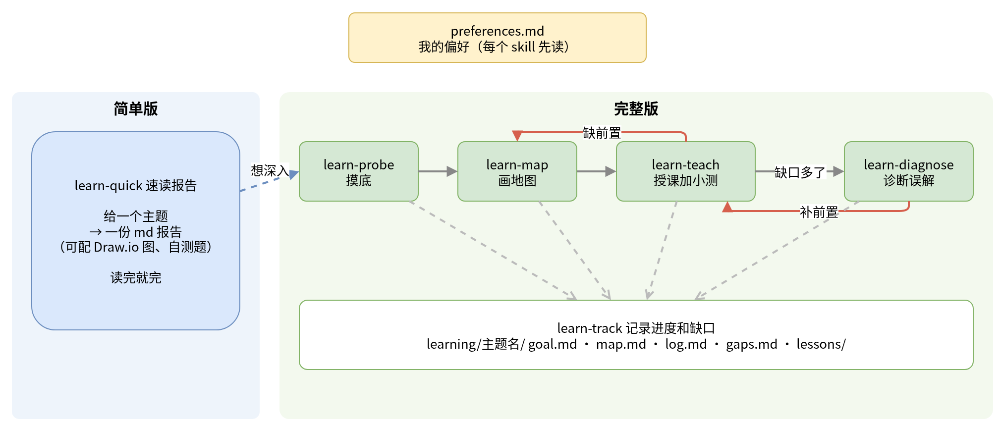

# 学习助手 skills

这里是这个仓库的成品：一套帮我用 AI 学新东西的 skill。它们都是标准的 `SKILL.md` 格式，每个文件开头一段 YAML 写着名字和"什么时候用"，正文写步骤。不依赖任何特定工具，Claude Code、Codex、Cursor、Grok Bot 都能读。

## 两个版本



**简单版**只有一个 skill，[learn-quick](learn-quick/SKILL.md)。给它一个主题，它交一份能从头读到尾的 md 报告，需要时配一张 Draw.io 图，末尾可以附几道自测题。不摸底、不建进度文件、不考试，读完就完。适合"我就想快速看懂这是什么"的时候。

**完整版**有五个 skill，分工不同，目标都是把一个主题真正学会，并且留下记录，下次能接着学：

| 顺序 | skill | 做什么 |
|---|---|---|
| 1 | [learn-probe](learn-probe/SKILL.md) 摸底 | 聊天式追问，摸清为什么学、学到什么程度、已经会到哪；建好主题文件夹 |
| 2 | [learn-map](learn-map/SKILL.md) 画地图 | 拆成粗分层的学习阶梯，用 Draw.io 画出来；卡住时往下补一层前置 |
| 3 | [learn-teach](learn-teach/SKILL.md) 授课加小测 | 一次讲一个节点，写成 md 讲义，再轻轻考一两下；答错记缺口，不卡人 |
| 4 | [learn-track](learn-track/SKILL.md) 记录进度和缺口 | 维护目标、地图、日志、缺口四个 md 文件，回答"我学到哪了" |
| 5 | [learn-diagnose](learn-diagnose/SKILL.md) 诊断误解 | 从日志和缺口里找出反复出现的同一个误解，补上它缺的前置 |

## 什么时候用哪个

没有单独的总调度 skill，每个 skill 的描述里已经写清了触发场景，工具会按描述自动挑。人工判断时按下面来：

- 只想看懂个大概，或者只要一份资料：**learn-quick**。
- 想系统学一个新主题：从 **learn-probe** 开始，它做完会接 **learn-map**，地图确认后进入 **learn-teach**。
- 之后每次回来继续学：直接 **learn-teach**，它会读记录，从上次停下的地方接着讲。
- 每次摸底、讲课、诊断之后：**learn-track** 更新记录。其他 skill 会按它规定的格式写文件，所以通常不用单独叫它；问进度时才直接用。
- 同一个地方老是错，或者缺口越积越多：**learn-diagnose**。
- 学到一半发现缺前置知识：回到 **learn-map** 补一层，再回 **learn-teach**。
- 速读报告读完想深入：转 **learn-probe**，报告当参考资料用。

所有 skill 开头都会读我的 [偏好文件](../preferences.md)。偏好改了，skill 的行为跟着变；某条偏好需要 skill 本身配合改动时，再改对应的 `SKILL.md`。

## 学习记录长什么样

完整版在我的学习仓库里，每个主题一个文件夹：

```
learning/<主题短名>/
  goal.md      目标、学习者画像、起点
  map.md       学习阶梯图 + 进度表
  map.drawio   地图源文件（导出的 map.png 放在旁边）
  log.md       每次学习的记录，最新的在上面
  gaps.md      缺口清单
  lessons/     每个节点的 md 讲义
```

四个文件的空白模板在 [learn-track/assets/](learn-track/assets/)，阶梯图的 Draw.io 模板在 [learn-map/assets/ladder-template.drawio](learn-map/assets/ladder-template.drawio)。

## 用到的外部能力

- **Draw.io。** 画地图和配图都用 Draw.io，不用 Mermaid。官方开源的 drawio skill 在 [jgraph/drawio-mcp](https://github.com/jgraph/drawio-mcp)（`plugins/claude-code/skills/drawio/SKILL.md`），Claude Code、Codex、Cursor、Copilot 都有插件，不需要 MCP。没有这个 skill 也能用：直接写 `.drawio` XML，装了 draw.io 桌面版就能导出 PNG，没装就交 `.drawio` 文件，在 app.diagrams.net 打开。
- **视频字幕。** AI 看不了视频，只能读文字。在 Grok Bot 上用全局 skill `video-transcript-sources`，工具在云电脑的 `/workspace/tools/video-transcript/`：给它 YouTube 或 B 站链接，先拿字幕，没有字幕就本地语音转文字，输出带时间戳跳转链接的文本。在别的工具里，用任何能拿字幕的办法（比如 yt-dlp）都行。
- **NotebookLM、MCP。** 不在主流程里，哪个 skill 都不要求。想用时自己接上。

## 安装

每个 skill 是一个文件夹，里面一个 `SKILL.md`（有的带 `assets/`）。把整个文件夹复制到工具读 skill 的位置：

| 工具 | 放在哪 |
|---|---|
| Claude Code | `~/.claude/skills/<skill 名>/`（全局）或项目里的 `.claude/skills/` |
| Codex | `~/.agents/skills/<skill 名>/`（全局）或项目里的 `.agents/skills/` |
| Cursor | `~/.cursor/skills/<skill 名>/`（全局）或项目里的 `.cursor/skills/`；它也会读 `~/.claude/skills/` |
| Grok Bot | 让 bot 把这些文件夹装进它的 skill 库 |
| 其他读 SKILL.md 的工具 | 按它的 skill 目录放；不支持 skill 的，把正文贴进系统提示或项目说明 |

一次装全部：

```bash
git clone https://github.com/aiyinyuedejustin/ai-learning-playbook.git
mkdir -p ~/.claude/skills ~/.agents/skills
cp -r ai-learning-playbook/skills/learn-* ~/.claude/skills/   # Claude Code，Cursor 也会读这里
cp -r ai-learning-playbook/skills/learn-* ~/.agents/skills/   # Codex
```

再把 [preferences.md](../preferences.md) 复制到你的学习仓库根目录，按自己的情况改。

## 每个 skill 从哪来

下面写每个 skill 的依据：参考了 [来源库](../sources/) 里哪些做法，对应 [偏好文件](../preferences.md) 里哪几条。来源条目都在括号里的分类文件中，按标题能找到。

### learn-probe 摸底

**为什么要摸底。** Eero Alvar 的"摸底、规划、授课"三段式是整个来源库里最完整的一套。他用分级选择题对每条前置做二分查找，找到会和不会的分界（[How I Use AI to Learn Things](https://www.youtube.com/watch?v=kzcI5F4tGiU&t=313s)，背后的仓库 [amosblomqvist/learn](https://github.com/amosblomqvist/learn)，见 [01-plan.md](../sources/01-plan.md)）。Math Academy 的 Justin Skycak 把"先知道学习者站在哪"列为压缩学习时间的第一步（[把一年的课压缩到更短的 7 步](https://x.com/justinskycak/status/2074212787690106923)，[01-plan.md](../sources/01-plan.md)）。Matt Pocock 的 /teach 被批评的两点之一，正是开课前不测前置（[用法帖及评论区](https://x.com/mattpocockuk/status/2064663221718425660)，[02-tutor.md](../sources/02-tutor.md)）。

**为什么做成聊天而不是选择题。** Nick Saraev 的"访谈者"角色先问清目标、水平和考核方式（[让 AI 扮演 9 种角色](https://www.youtube.com/watch?v=FSXHk4hMrY8)，[02-tutor.md](../sources/02-tutor.md)），Matt Pocock 的 /grill-me 一轮轮追问直到双方理解一致（[mattpocock/skills](https://github.com/mattpocock/skills)，[02-tutor.md](../sources/02-tutor.md)）。Explain This 把摸底结果写成每次都读的学习者画像（[Explain This](https://x.com/daniel_mac8/status/2078146026993594727)，[02-tutor.md](../sources/02-tutor.md)）。Eero 视频评论区的反对意见是"零基础时摸底会全错"，所以这里摸不出底就从最基础的词开始，不卡住。

**对应偏好：** 摸底要做但要随性、不用选择题卡片；支持语音碎碎念；先讲后考。

### learn-map 画地图

**为什么画阶梯。** B 站"学习阶梯分层法"视频把目标拆成有先后关系的几级台阶，上一级掌握了才往下一级走（[如何用 Claude 以 10 倍速度学习任何东西](https://www.bilibili.com/video/BV1eGTj69EKB)，[11-zh.md](../sources/11-zh.md)）。Math Academy 用细粒度的知识图谱（[How Math Academy creates its knowledge graph](https://justinmath.com/how-math-academy-creates-its-knowledge-graph/)，[01-plan.md](../sources/01-plan.md)），Eero 让 AI 先画依赖图再开讲，说画图主要是逼 AI 把每一步想清楚。这里取中间：粗分层，卡住再往下补，和 Sheriaties 的"分层前置、递归学习"一个思路（[Sheriaties/adaptive-learning-skill](https://github.com/Sheriaties/adaptive-learning-skill)，[01-plan.md](../sources/01-plan.md)）。

**为什么要核对资料。** Matt Pocock 的 /teach 强制外搜高可信资料写进 RESOURCES.md，不信模型的记忆（[mattpocock/skills](https://github.com/mattpocock/skills)，[02-tutor.md](../sources/02-tutor.md)）；Eero 用子 agent 做事实核查。

**为什么用 Draw.io。** 来源里的依赖图大多用 Mermaid，但 Mermaid 排版不可控、层多了就乱，我更想要能编辑、好看的图，所以换成 Draw.io。

**对应偏好：** 路径用粗分层阶梯，默认 5 到 12 个节点、不是硬规矩、不必项目驱动；地图用 Draw.io、不用 Mermaid。

### learn-teach 授课加小测

**为什么先讲后考。** Eero 的每个节点都按"为什么需要、讲清或推导、连到学过的、当场一道小测"走一遍，这里的讲义结构基本照搬（[amosblomqvist/learn](https://github.com/amosblomqvist/learn)，[01-plan.md](../sources/01-plan.md)）。来源里也有苏格拉底派，主张先问后讲（[02-tutor.md](../sources/02-tutor.md) 整类），我选了先讲。

**为什么一定要考一下，但考得轻。** Anthropic 的实验里，让 AI 代劳的一组测验平均 50 分，自己动手的一组 67 分，得分高的人会追问为什么（[AI 辅助如何影响编程技能的形成](https://www.anthropic.com/research/AI-assistance-coding-skills)，[03-code.md](../sources/03-code.md)）；Bastani 等人发现没有护栏的 GPT 会伤害学习（[PNAS 论文](https://www.pnas.org/doi/10.1073/pnas.2422633122)，[09-science.md](../sources/09-science.md)）。只看懂讲解容易产生流畅感错觉（[Justin Sung：用 AI 学得更快，但不伤大脑](https://www.youtube.com/watch?v=4gQIAXjraLo)，[08-system.md](../sources/08-system.md)）。所以每个节点都考一下，但按我的偏好不卡人，答错只记缺口。Lucas Soares 的"先测，只记答错的"也是这个思路（[先测再做卡](https://www.youtube.com/watch?v=RocA3wA3QjU)，[04-cards.md](../sources/04-cards.md)），只是我不做卡，记进缺口清单。

**为什么 HTML 只在需要时做。** Simon Willison 的交互式讲解对流程、算法这类东西很有用（[Interactive explanations](https://simonwillison.net/guides/agentic-engineering-patterns/interactive-explanations/)，[03-code.md](../sources/03-code.md)），Anthropic 也写过 HTML 讲解的好处（[The unreasonable effectiveness of HTML](https://claude.com/blog/using-claude-code-the-unreasonable-effectiveness-of-html)，[05-html.md](../sources/05-html.md)）。但大多数节点文字加一张图就够，所以默认 md，需要时再做。

**为什么动手练习先零成本。** linux.do 上"AI 写完我手动 debug 再手写一遍"（[03-code.md](../sources/03-code.md)）和 Nick Saraev 的"通过后不看提示再做一遍"都说明动手的价值；但不是每个主题都方便动手，所以不强制，想练时先找免费的练法。

**对应偏好：** 先讲后考；软放行、软验收；不强制动手、需要时帮忙想练法；讲解用 md、需要时出 HTML 测验；练习题不写死、拿不准时问；不限时长；不写死流程。

### learn-track 记录进度和缺口

**为什么是四个 md 文件。** 中文 X 上有人只用 log.md、open.md、plan.md 三个文件维持学习状态（[@conjsslbm](https://x.com/conjsslbm/status/2105230345851588984)，[07-notes.md](../sources/07-notes.md)）；Matt Pocock 的 /teach 把一个目录当成一门课，MISSION、RESOURCES、learning-records 各有一个位置（[mattpocock/skills](https://github.com/mattpocock/skills)，[02-tutor.md](../sources/02-tutor.md)）；xuexi-learning-skill 用主题文件夹加进度.md 和错题记录（[zifengyuan6-star/xuexi-learning-skill](https://github.com/zifengyuan6-star/xuexi-learning-skill)，[01-plan.md](../sources/01-plan.md)）。这里合并成目标、地图（兼进度表）、日志、缺口四个。

**为什么不做卡片、不定时推送。** 来源里卡片和间隔复习的讨论最多（[04-cards.md](../sources/04-cards.md) 有 64 条），但 Andy Matuschak 自己说，挑出 AI 生成的废卡比自己写还累（[丢掉 1/3 AI 卡的成本比自己写 2/3 还高](https://x.com/andy_matuschak/status/2046640847161262574)，[04-cards.md](../sources/04-cards.md)），Memory Machines 的评测也发现大约三分之一的 AI 卡不能用（[报告](https://memory-machines.com/report/)，[04-cards.md](../sources/04-cards.md)）。东门那期讲"第二大脑"反面意见的视频也提醒：装工具不等于进步（[YouTube](https://www.youtube.com/watch?v=3l2v0Vxhr6g)）。我先用最轻的进度表加缺口清单，以后真觉得忘得快，再加卡片。

**对应偏好：** 记录存 GitHub 仓库、每主题四个 md；不做卡片；复习靠进度表加缺口清单、不默认 Anki；不定时推送。

### learn-diagnose 诊断误解

**为什么单独做一个诊断。** Nick Saraev 的"诊断者"角色读你最近几次对话，找出反复出现的同一个误解（[让 AI 扮演 9 种角色](https://www.youtube.com/watch?v=FSXHk4hMrY8)，[02-tutor.md](../sources/02-tutor.md)），这是来源里很少见、又很容易落地的一个动作。universal-diagnostic-tutor-skill 也专门做卡点诊断和掌握证据（[SenmuuuuW/universal-diagnostic-tutor-skill](https://github.com/SenmuuuuW/universal-diagnostic-tutor-skill)，[02-tutor.md](../sources/02-tutor.md)）。"缺的前置要往回补"来自 Math Academy 的掌握放行思路（[The Math Academy Way](https://www.justinmath.com/files/the-math-academy-way.pdf)，[01-plan.md](../sources/01-plan.md)），只是我这里不卡人，改成事后诊断再补。

**对应偏好：** 软放行只记缺口（缺口攒多了需要有人回头整理）；不写死流程。

### learn-quick 速读报告

**为什么要一个简单版。** 有时我只想要一份报告顺着看。Simon Willison 的线性讲解就是一份带真实例子、从头读到尾的 md 文档（[Linear walkthroughs](https://simonwillison.net/guides/agentic-engineering-patterns/linear-walkthroughs/)，[03-code.md](../sources/03-code.md)）；B 站学习阶梯视频里的"一页速查表"把一个主题压缩成定义、关键概念、例子、常见错误、自测题（[11-zh.md](../sources/11-zh.md)）；Sean Goedecke 写过用 LLM 读懂新领域的做法（[How I use LLMs to learn new subjects](https://www.seangoedecke.com/learning-from-llms)，[08-system.md](../sources/08-system.md)）。报告结构由浅入深，最后的自测题来自检索练习的证据（[Dunlosky 等：十种学习方法的效用评估](https://www.psychologicalscience.org/publications/journals/pspi/learning-techniques.html)，[09-science.md](../sources/09-science.md)）。

**为什么报告里要有行话速查表。** 很多领域的讨论里满是缩写和代号，不懂代号就看不懂别人在说什么；Lencx 也提醒别让 AI 一直用小白口吻，要用专家的说法再解释（[@0xqiuqiuu 转述](https://x.com/0xqiuqiuu/status/2049685049818419219)，[02-tutor.md](../sources/02-tutor.md)）。

**对应偏好：** 有时只要一份报告；讲解用 md；地图和配图用 Draw.io；不写死流程。
