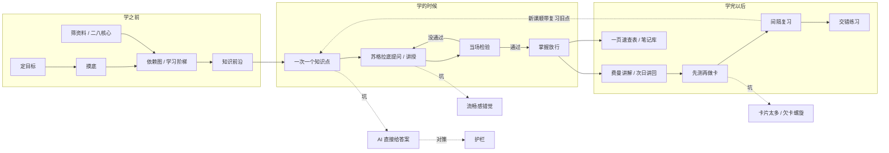

# 来源库

这个目录收集"怎么用 AI 学一个新领域"的一手来源：别人的博客、帖子、视频、开源工具和研究论文，一共 325 条。它是整本书的原材料层。外面的章节是在这些来源之上做的讲解和归纳；这里只记录每个来源本身说了什么、做了什么、哪些可以借用，不下最终结论。

来源尽量多收。一个方法只要有人真的在用，就记下来，哪怕它绑定了某个特定工具（pi、Notion、Obsidian、某个产品）。绑定关系写在"依赖"一栏里，读的人可以自己判断能不能移植。推广帖和无法核实的说法也保留，统一放在最后一类并给低分。

## 怎么读一条来源

每个分类一个文件。每条来源都有同样的几栏：

- **方式**：它用的学习方式，比如摸底、依赖图、苏格拉底提问、检索练习、间隔复习、费曼讲解。
- **产物**：学完留下了什么，比如 md 笔记、HTML 课程、闪卡、测验、代码、学习日志。没有留下东西的写"无"。
- **工具**：用到的软件或模型（Claude Code、Codex、Grok、ChatGPT、NotebookLM、Obsidian、Notion、Anki、pi 等），以及是否需要 MCP。
- **依赖**："通用"表示方法本身不绑定工具，换一个 agent 也能做；"依赖某某"表示离开这个工具就要改造。
- **做法**：它具体怎么做，三到五句话。视频尽量给出带时间戳的链接。
- **可借鉴**：哪一点值得拿来用，或者需要警惕什么。

评分是按"对自己搭学习流程有多大用处"打的，不是按名气：

- 5 分：核心来源，方法清楚、可以直接借用，或者是关键证据。
- 4 分：很有价值，有一两个可以直接用的做法。
- 3 分：有用的补充或旁证。
- 2 分：边缘内容，信息少、方法常规，或者只读到了标题和摘要。
- 1 分：推广、复制帖、无法核实，或者只确认了页面存在。

几点说明。Reddit 和知乎的正文大多读不到，这些条目是根据搜索摘要写的，正文里会注明，评分也相应偏低。X 上的赞数和收藏数是抓取时的数字，会变。GitHub 星数同理。

## 关键术语

学习方法的说法很多，同一件事常有好几个名字。下面是这个来源库里反复出现的词，以及它们在这里的意思。

| 术语 | 意思 | 在哪些来源里最典型 |
|---|---|---|
| 摸底 | 开始学之前，先用题目测出学习者已经会什么、不会什么。好的摸底不止找到一个错题，而是找到"会"和"不会"的边界。 | Eero Alvar 的二分查找式摸底，sosplit 的定制摸底卷 |
| 知识前沿（最近发展区） | 前置都已掌握、自己还不会、但在帮助下够得着的那一圈内容。学习效果最好的位置就在这里。 | Skycak 的 7 步，Matt Pocock 的 /teach |
| 依赖图 | 把要学的知识点画成一张图，箭头表示"学 B 之前要先会 A"。常用 Mermaid 或 md 列表表示。 | Eero 的 Mermaid 图，Math Academy 知识图谱，Sheriaties 的分层前置 |
| 学习阶梯（分层） | 把一个领域拆成几个等级，每一级写清要掌握什么、常见错误、达到什么标准才能进入下一级。是依赖图的简化版。 | B 站"学习阶梯"视频，koganei 的分段编号路径 |
| 掌握放行 | 当前知识点通过检验才进入下一个，没通过就补课或换一条平行路线。 | Skycak，xuexi-learning-skill 的四档判定，repo-mastery |
| 检索练习 | 不看材料，从记忆里把答案"掏"出来。比重读有效得多，是证据最强的学习方法之一。 | Dunlosky 综述，Timtis 的会话表 |
| 先测再做卡 | 先做题，只把答错的点做成闪卡。卡片少而准。 | Lucas Soares，Explain This |
| 间隔复习 | 按遗忘规律安排复习时间，间隔越来越长。常用算法有 SM-2 和更新的 FSRS。 | Cepeda 研究，fsrs4anki，各种 Anki MCP |
| 交错练习 | 把相似但不同的题型混在一起练，帮助分辨该用哪种方法。 | 《Make It Stick》，Math Academy |
| 合意困难 | 学的时候更费力，之后反而记得更牢。AI 太流畅的讲解会把这部分困难拿掉。 | The Effortless Trap，Scott Young 的"必要的难" |
| 流畅感错觉 | 读懂了别人的讲解，就以为自己会了。第二天或者合上材料就露馅。 | Justin Sung 的问卷，Timtis 的警告信号 |
| 苏格拉底提问 | 导师不直接给答案，而是用一连串问题引导你自己想出来。卡太久时要退回讲授。 | socrates-skill，半苏格拉底导师 |
| 费曼讲解 | 用自己的话把一个概念讲出来，讲不清的地方就是没懂的地方。 | lukasen_xyz 的反向费曼，B 站 Maki 的讲稿法 |
| 次日讲回 | 睡一觉之后再闭卷讲一遍，测的是巩固后的记忆，而不是当场的短期记忆。 | Learning Harness |
| 二八核心 | 一个领域里最常用、最能带来结果的那一小部分内容，先学它。 | B 站学习阶梯视频，Stuart Dalrymple 的二八地图 |
| 一页速查表 | 学完一个主题，把它压缩成一页：一句话定义、关键概念、例子、常见错误、自测题。 | B 站学习阶梯视频，the-knowledge-guy 的概念地图 |
| 学习者画像 | 一份让 AI 每次都读的文件，记录你的背景、目标、已知和偏好。 | Explain This 的 LEARNER.md，LAQ 的 Brain File |
| 认知债 | agent 写代码比人理解得快，没理解的部分像债一样累积。 | Geoffrey Litt，Vivek Haldar |
| 护栏 | 限制 AI 不在你尝试之前给出完整答案的规则。 | Bastani 的 GPT Tutor，beingMana 的 Grok 指令 |

## 概念地图

下面这张图把上面的术语串成一条学习流程。左边是"学之前"，中间是"学的时候"，右边是"学完以后"；虚线指向的是这条流程里最常见的几个坑。

## 分类

| 分类 | 文件 | 条目数 | 说明 |
|---|---|---|---|
| 摸底与规划 | [01-plan.md](01-plan.md) | 20 | 这一类来源回答"从哪里开始学、按什么顺序学"。 |
| 一对一授课与苏格拉底 | [02-tutor.md](02-tutor.md) | 44 | 这一类来源讨论 AI 在授课时该怎么说话：一次只问一个问题，先让你试再给提示，不接受"我懂了"，卡住时退回去讲。 |
| 编程边做边学 | [03-code.md](03-code.md) | 23 | 编程是"必须亲手做"的技能，也是 AI 最容易代劳的领域。 |
| 卡片与间隔复习 | [04-cards.md](04-cards.md) | 64 | 这一类来源都和"学完之后怎么不忘"有关：间隔复习算法、Anki 和 AI 之间的桥（多数需要 MCP 或 AnkiConnect）、制卡原则，以及大量关于"该不该让 AI 做卡"的讨论。 |
| 交互式讲解与 HTML | [05-html.md](05-html.md) | 16 | 文字讲不懂时，让 AI 做一个能动手玩的页面、动画或模拟。 |
| 读资料与 NotebookLM | [06-read.md](06-read.md) | 18 | 这一类是"手上有一堆资料，怎么借 AI 读进去"。 |
| 笔记与知识库 | [07-notes.md](07-notes.md) | 15 | 这一类关心学习留下的长期产物：Karpathy 式的 raw 加 wiki，Obsidian 库，几份 md 文件组成的学习状态，以及"今天学到了什么"仓库。 |
| 完整学习系统与工作流 | [08-system.md](08-system.md) | 48 | 这一类是个人完整的学习方法：从定目标、找资料、上课、自测到复习的一整套流程，以及各种学习 skill、学习应用和讨论帖。 |
| 学习科学与研究证据 | [09-science.md](09-science.md) | 26 | 这一类是支撑其他各类做法的研究：间隔效应、检索练习、合意困难，以及 AI 导师的对照实验。 |
| 反对与风险证据 | [10-critic.md](10-critic.md) | 15 | 这一类收集"用 AI 学习可能更糟"的证据和声音：成绩下降的实验、流畅感错觉、过度依赖的现身说法，以及对学习工具本身的怀疑。 |
| 中文社区经验 | [11-zh.md](11-zh.md) | 24 | 这一类来自 linux.do、V2EX、少数派、知乎、B 站和中文 X。 |
| 推广与存疑 | [12-promo.md](12-promo.md) | 12 | 这一类是传播很广但可信度低的内容：无法核实的爆款故事、逐字复制的模板帖、评论区推销和导流号。 |

视频的转写文本放在 [raw/transcripts/](raw/transcripts/)，文件名是视频编号。有字幕的用字幕，没有字幕的用本地语音识别，识别结果里会有错别字，引用前请对照原视频。

## 总表

下表列出全部来源，按分类、再按评分排列。"方式"一栏就是这条来源的方法要点。

| 分类 | 来源 | 作者 | 方式 | 产物 | 工具 | 依赖 | 评分 |
|---|---|---|---|---|---|---|---|
| 摸底与规划 | [How I Use AI to Learn Things（摸底→规划→授课三段式）](https://www.youtube.com/watch?v=kzcI5F4tGiU&t=313s) | Eero Alvar | 摸底、依赖图、逐点授课、随堂测 | Obsidian 学习日志（md）、Mermaid 图、SVG 配图、选择题 | pi 框架、Obsidian、子 agent（需 tmux） | 依赖 pi，思路通用 | 5 |
| 摸底与规划 | [amosblomqvist/learn（Eero 视频背后的仓库）](https://github.com/amosblomqvist/learn) | Amos Blomqvist | 摸底、依赖图、逐点授课、随堂测 | md 日志、选择题、SVG/Mermaid 图 | pi 框架、Obsidian、tmux 子 agent | 依赖 pi | 5 |
| 摸底与规划 | [Justin Skycak：把一年的课压缩到更短的 7 步](https://x.com/justinskycak/status/2074212787690106923) | Justin Skycak（Math Academy） | 摸底、知识图谱、掌握放行、间隔复习 | 个人知识画像、练习 | Math Academy（可脱离） | 通用 | 5 |
| 摸底与规划 | [How Math Academy creates its knowledge graph](https://justinmath.com/how-math-academy-creates-its-knowledge-graph/) | Justin Skycak | 依赖图、掌握放行 | 知识图谱 | 无 | 通用 | 4 |
| 摸底与规划 | [The Math Academy Way（PDF）](https://www.justinmath.com/files/the-math-academy-way.pdf) | Justin Skycak | 掌握放行、间隔复习、检索练习、交错 | 无 | 无 | 通用 | 4 |
| 摸底与规划 | [lowwwbank/anything-to-course](https://github.com/lowwwbank/anything-to-course) | lowwwbank | 规划、检索练习、间隔复习、导师模式 | 课程目录 md、答案目录、复习日程 | 任意读 SKILL.md 的 agent | 通用 | 4 |
| 摸底与规划 | [sosplit/adaptive-learning-course（中文）](https://github.com/sosplit/adaptive-learning-course) | sosplit | 访谈、摸底、方案确认、逐课练习 | 本地网页课、JSON 答卷、学习档案 | 任意 agent（可选本地 Python 服务） | 通用 | 4 |
| 摸底与规划 | [sai-7i/daxue-zhidao 大学之道（中文）](https://github.com/sai-7i/daxue-zhidao) | sai-7i | 技术地图、单元制授课、掌握验证 | 技术地图、课程进度 md | 6 种宿主（Claude Code、Codex 等） | 通用 | 4 |
| 摸底与规划 | [zifengyuan6-star/xuexi-learning-skill（中文）](https://github.com/zifengyuan6-star/xuexi-learning-skill) | zifengyuan6-star | 掌握学习、检查站、补充课、复习提醒 | 主题文件夹、每课 md、进度.md、错题和遗漏记录 | CLAUDE.md（任意 agent） | 通用 | 4 |
| 摸底与规划 | [Justin Skycak：认知举重的三条原则](https://x.com/justinskycak/status/2070136427422314529) | Justin Skycak | 检索练习、掌握放行、间隔复习 | 无 | 无 | 通用 | 3 |
| 摸底与规划 | [X @raphaeltraviss：一句话生成"技能节点 + 依赖"的学习系统](https://x.com/raphaeltraviss/status/2107836939218952281) | raphaeltraviss | 依赖图、交互探索 | 单文件 HTML 学习页 | 任意能写 HTML 的模型 | 通用 | 3 |
| 摸底与规划 | [koganei/learn-anything-skill](https://github.com/koganei/learn-anything-skill) | koganei | 规划、讲授 | 分级学习路径（md） | Claude Code skill | 依赖 Claude Code，可移植 | 3 |
| 摸底与规划 | [Sheriaties/adaptive-learning-skill（中文）](https://github.com/Sheriaties/adaptive-learning-skill) | Sheriaties | 分层前置、递归学习、理解验证 | Obsidian 概念笔记、MOC 学习地图 | Claude Code / OpenClaw / Hermes，Obsidian | 依赖 Obsidian 目录结构 | 3 |
| 摸底与规划 | [SugarMGP/study.skill 学习.skill（中文）](https://github.com/SugarMGP/study.skill) | SugarMGP | 锚定目标、调研资料、生成课程、陪学、间隔复习 | 课程目录、讲义、互动练习、复习排期 | 任意 agent，本地课程播放器 | 通用（播放器可选） | 3 |
| 摸底与规划 | [X @gabriel1：现在可以自上而下学任何东西](https://x.com/gabriel1/status/2026945947352363127) | gabriel1 | 观点、规划 | 无 | 无 | 通用 | 3 |
| 摸底与规划 | [X @nilslang：通用 AI 导师可行的前提](https://x.com/nilslang/status/2087671103208464586) | nilslang | 观点 | 无 | 无 | 通用 | 2 |
| 摸底与规划 | [malberich/skill-tutor](https://github.com/malberich/skill-tutor) | malberich | 摸底、规划、间隔复习、交错 | 学习路径 | Claude Code 或 Claude.ai skill | 依赖 Claude，可移植 | 2 |
| 摸底与规划 | [microsoft/ai-agents-for-beginners（课程结构参考）](https://github.com/microsoft/AI-AGENTS-FOR-BEGINNERS) | Microsoft | 课程结构 | 每课 README、视频、代码 | 无 | 通用 | 2 |
| 摸底与规划 | [Haozhe-Xing/agent_learning（课程结构参考）](https://github.com/Haozhe-Xing/agent_learning) | Haozhe-Xing | 课程结构 | 分章 md | 无 | 通用 | 2 |
| 摸底与规划 | [minicoohei/ai-agent-camp（课程结构参考）](https://github.com/minicoohei/ai-agent-camp) | minicoohei | 课程结构 | 几十个模块、lessons 清单 | 无 | 通用 | 2 |
| 一对一授课与苏格拉底 | [Nick Saraev：让 AI 扮演 9 种角色](https://www.youtube.com/watch?v=FSXHk4hMrY8) | Nick Saraev | 访谈、地图、苏格拉底、考官、检查、倾听、诊断、陪练、书记 | 无固定产物 | 任意聊天模型 | 通用 | 5 |
| 一对一授课与苏格拉底 | [mattpocock/skills：/teach 与 /grill-me](https://github.com/mattpocock/skills) | Matt Pocock | 有状态课程工作区、最近发展区、追问对齐 | MISSION.md、RESOURCES.md、lessons/*.html、learning-records/、reference/ | 任意读 SKILL.md 的 agent（npx skills add） | 通用 | 5 |
| 一对一授课与苏格拉底 | [Matt Pocock："从初级到高级"用法帖及评论区批评](https://x.com/mattpocockuk/status/2064663221718425660) | Matt Pocock | 有状态课程工作区 | HTML 课 | 任意 agent | 通用 | 5 |
| 一对一授课与苏格拉底 | [Explain This（@daniel_mac8）](https://x.com/daniel_mac8/status/2078146026993594727) | Dan Mac | 学习者画像、锚定已有知识的讲解、测验转卡 | LEARNER.md、Obsidian 讲解笔记、SRS 卡 | Claude Code skill、Obsidian | 依赖 Obsidian，思路通用 | 5 |
| 一对一授课与苏格拉底 | [Claude Code output styles（Learning / Explanatory）](https://code.claude.com/docs/en/output-styles) | Anthropic | 边做边学、讲解 | 代码里的 TODO(human) | Claude Code | 依赖 Claude Code | 4 |
| 一对一授课与苏格拉底 | [X @gabriel1：征集"学得更快"的 custom instructions](https://x.com/gabriel1/status/1915161838129746270) | gabriel1 | 提问技巧 | 无 | 任意聊天模型 | 通用 | 4 |
| 一对一授课与苏格拉底 | [X @lukasen_xyz：反向费曼，讲给 AI 听](https://x.com/lukasen_xyz/status/2110867960185434502) | lukasen_xyz | 费曼讲解 | 无 | 任意聊天模型 | 通用 | 4 |
| 一对一授课与苏格拉底 | [Justin Sung：ChatGPT Study Mode 评测](https://www.youtube.com/watch?v=m3jNwwuvqx8) | Justin Sung | 精确提问 | 无 | ChatGPT Study Mode | 通用 | 4 |
| 一对一授课与苏格拉底 | [Matt Pocock：/teach 发布帖](https://x.com/mattpocockuk/status/2063988995692900439) | Matt Pocock | 有状态课程工作区 | HTML 课 | 任意 agent（npx skills add） | 通用 | 4 |
| 一对一授课与苏格拉底 | [kirilxd/claude-tutor](https://github.com/kirilxd/claude-tutor) | kirilxd | 规划、讲授、测验、间隔复习 | 学习计划、测验、复习日历、Web 面板 | Claude Code | 依赖 Claude Code | 4 |
| 一对一授课与苏格拉底 | [bevibing/tutor-skills](https://github.com/bevibing/tutor-skills) | bevibing | 资料建库、每轮出题、掌握追踪 | Obsidian StudyVault | Claude Code、Obsidian | 依赖 Obsidian | 4 |
| 一对一授课与苏格拉底 | [SenmuuuuW/universal-diagnostic-tutor-skill（中文）](https://github.com/SenmuuuuW/universal-diagnostic-tutor-skill) | SenmuuuuW | 诊断卡点、掌握证据 | 无固定产物 | 任意 agent | 通用 | 4 |
| 一对一授课与苏格拉底 | [robotsatemyhomework：用 Claude 做一个不接受"我懂了"的导师](https://robotsatemyhomework.substack.com/p/the-ai-tutor-i-built-in-claude-that) | Mia Kiraki | 检索练习、苏格拉底 | Claude Project 指令 | Claude Projects | 依赖 Claude Projects，可移植 | 4 |
| 一对一授课与苏格拉底 | [Mr. Ranedeer AI Tutor](https://github.com/JushBJJ/Mr.-Ranedeer-AI-Tutor) | JushBJJ | 个性化讲授 | 无（对话） | ChatGPT（GPT-4 时代） | 依赖 ChatGPT，已停更 | 3 |
| 一对一授课与苏格拉底 | [Crafting a Semi-Socratic Tutor with ChatGPT](https://www.socraticarts.com/blog/crafting-a-semi-socratic-tutor-with-chatgpt) | Breanne Grover（Socratic Arts） | 半苏格拉底 | 提示词 | ChatGPT | 通用 | 3 |
| 一对一授课与苏格拉底 | [Assigning AI: Seven Ways of Using AI in Class](https://substack.com/home/post/p-127669714) | Ethan Mollick、Lilach Mollick | 导师、教练、对练等七种角色 | 提示词 | 任意聊天模型 | 通用 | 3 |
| 一对一授课与苏格拉底 | [Using AI to make teaching easier & more impactful](https://oneusefulthing.substack.com/p/using-ai-to-make-teaching-easier) | Ethan Mollick | 检索练习、间隔、例题、解释 | 提示词 | 任意聊天模型 | 通用 | 3 |
| 一对一授课与苏格拉底 | [ChatGPT Study Mode 官方介绍](https://openai.com/index/chatgpt-study-mode/) | OpenAI | 苏格拉底、分步、知识检查 | 无（对话） | ChatGPT | 依赖 ChatGPT | 3 |
| 一对一授课与苏格拉底 | [beingMana：给孩子用的 Grok 辅导指令](https://x.com/beingMana/status/2090265695770779809) | beingMana | 苏格拉底、现实应用 | 无（对话） | Grok | 通用 | 3 |
| 一对一授课与苏格拉底 | [X @julianboolean_：Math Academy + 苏格拉底式 LLM](https://x.com/julianboolean_/status/2090571881753530735) | julianboolean_ | 苏格拉底、直觉讲解 | 无 | Math Academy + 任意 LLM | 通用 | 3 |
| 一对一授课与苏格拉底 | [X @gabriel1：学不快是技能问题](https://x.com/gabriel1/status/1913034792398131432) | gabriel1 | 追问、复习旧对话 | 无 | 任意聊天模型 | 通用 | 3 |
| 一对一授课与苏格拉底 | [X @drrobcincotta：个人 Journal Club](https://x.com/drrobcincotta/status/2087277731579146502) | drrobcincotta | 被面试、费曼讲解、隔几天再考 | 笔记与链接 | 任意聊天模型 | 通用 | 3 |
| 一对一授课与苏格拉底 | [X @0xqiuqiuu 转述 Lencx：别让 AI 用小白口吻](https://x.com/0xqiuqiuu/status/2049685049818419219) | 0xqiuqiuu | 专家视角讲解 | 无 | 任意聊天模型 | 通用 | 3 |
| 一对一授课与苏格拉底 | [Bhala-Srinivash/agent-tutor-skill](https://github.com/Bhala-Srinivash/agent-tutor-skill) | Bhala-Srinivash | 讲解、例子、检查、练习、间隔复习 | ~/.learn/ 学习档案、复习队列 | 任意 agent | 通用 | 3 |
| 一对一授课与苏格拉底 | [mordor-forge/study-skill](https://github.com/mordor-forge/study-skill) | mordor-forge | 交互学习、间隔复习 | 学习会话、复习调度 | Claude Code | 依赖 Claude Code | 3 |
| 一对一授课与苏格拉底 | [bevibing/socrates-skill](https://github.com/bevibing/socrates-skill) | bevibing | 苏格拉底 | 无（对话） | Claude Code | 依赖 Claude Code，可移植 | 3 |
| 一对一授课与苏格拉底 | [cdmorozov/claude-tutors](https://github.com/cdmorozov/claude-tutors) | cdmorozov | 克制型辅导 | 无（对话） | Claude Code | 依赖 Claude Code | 3 |
| 一对一授课与苏格拉底 | [FlorianBruniaux：learning-mode.md（CLAUDE.md 模板）](https://github.com/FlorianBruniaux/claude-code-ultimate-guide/blob/main/examples/claude-md/learning-mode.md) | Florian Bruniaux | 学习模式规则 | CLAUDE.md | Claude Code（可移植到 AGENTS.md） | 通用 | 3 |
| 一对一授课与苏格拉底 | [mustvlad/ChatGPT-System-Prompts：Socratic Tutor](https://github.com/mustvlad/ChatGPT-System-Prompts/blob/main/prompts/educational/socratic-tutor.md) | mustvlad | 苏格拉底 | 无（对话） | 任意聊天模型 | 通用 | 2 |
| 一对一授课与苏格拉底 | [Socratic tutoring（DeepakNess 笔记）](https://deepakness.com/raw/socratic-tutoring) | DeepakNess | 苏格拉底 | 提示词汇编 | 任意聊天模型 | 通用 | 2 |
| 一对一授课与苏格拉底 | [Gemini Guided Learning 官方介绍](https://blog.google/products-and-platforms/products/education/guided-learning/) | Google | 引导式学习 | 图、视频、闪卡 | Gemini | 依赖 Gemini | 2 |
| 一对一授课与苏格拉底 | [X @gabriel1：怎么用 ChatGPT 学 ML](https://x.com/gabriel1/status/1918431395644621033) | gabriel1 | 提问 | 无 | 任意聊天模型 | 通用 | 2 |
| 一对一授课与苏格拉底 | [Claude 学习可视化教程（Imagine with Claude）](https://claude.com/resources/tutorials/imagine-with-claude-student-guide) | Anthropic | 可视化、测验 | 交互可视化 | Claude | 依赖 Claude | 2 |
| 一对一授课与苏格拉底 | [shauigewhite/learning-tutor](https://github.com/shauigewhite/learning-tutor) | shauigewhite | 前测、后测、多种教法 | 学习者画像 | Claude Code | 依赖 Claude Code | 2 |
| 一对一授课与苏格拉底 | [Mohamed-El-Sharqawy/agent-tutor](https://github.com/Mohamed-El-Sharqawy/agent-tutor) | Mohamed-El-Sharqawy | 辅导、测验、间隔复习 | Obsidian 复习队列 | Claude Code、Obsidian | 依赖 Obsidian | 2 |
| 一对一授课与苏格拉底 | [sbkriz/feynman-tutor](https://github.com/sbkriz/feynman-tutor) | sbkriz | 费曼讲解 | 学习者笔记 | Claude Code | 依赖 Claude Code | 2 |
| 一对一授课与苏格拉底 | [Show HN: thinkqurio，给女儿写作业用的苏格拉底工具](https://news.ycombinator.com/item?id=47036610) | thinkqurio 作者 | 苏格拉底 | 网页产品 | 自研产品 | 依赖该产品 | 2 |
| 一对一授课与苏格拉底 | [X @jonedmiston：看到 GPT-6 交互 UI 后想扔掉自己的 /teach-me](https://x.com/jonedmiston/status/2107925510571597876) | jonedmiston | 观点 | 无 | 无 | 通用 | 1 |
| 一对一授课与苏格拉底 | [voidstackloop/expert-mentor](https://github.com/voidstackloop/expert-mentor) | voidstackloop | 跨会话导师 | 学习记忆 | Claude Code | 依赖 Claude Code | 1 |
| 一对一授课与苏格拉底 | [3LivesLeft/sensei](https://github.com/3LivesLeft/sensei) | 3LivesLeft | 辅导 | 无 | Claude Code | 依赖 Claude Code | 1 |
| 一对一授课与苏格拉底 | [BlueBirdBack/english-coach：英语教练 skill（中文）](https://github.com/BlueBirdBack/english-coach) | BlueBirdBack | 语言陪练 | 无 | Hermes | 依赖 Hermes | 1 |
| 一对一授课与苏格拉底 | [zjlylcking/pangshu-ai-beginner-coach：胖叔 AI 入门老师（中文）](https://github.com/zjlylcking/pangshu-ai-beginner-coach) | zjlylcking | 新手入门辅导 | 无 | 任意 agent | 通用 | 1 |
| 一对一授课与苏格拉底 | [wilsondd-lab/nachuan-stu：初高中学习 skill 合集（中文）](https://github.com/wilsondd-lab/nachuan-stu) | wilsondd-lab | 中学辅导 | 无 | 任意 agent | 通用 | 1 |
| 一对一授课与苏格拉底 | [markbeachill/tutorprompts](https://github.com/markbeachill/tutorprompts) | markbeachill | 导师提示词 | 提示词 | 任意 LLM | 通用 | 1 |
| 编程边做边学 | [Anthropic：AI 辅助如何影响编程技能的形成（RCT）](https://www.anthropic.com/research/AI-assistance-coding-skills) | Anthropic | 对照实验 | 论文 | 无 | 通用 | 5 |
| 编程边做边学 | [Simon Willison：Interactive explanations](https://simonwillison.net/guides/agentic-engineering-patterns/interactive-explanations/) | Simon Willison | 线性讲解、动画讲解 | 交互 HTML 动画 | 任意编码 agent | 通用 | 5 |
| 编程边做边学 | [zarazhangrui/codebase-to-course](https://github.com/zarazhangrui/codebase-to-course) | Zara Zhang | 代码库变课程、应用型测验 | 单文件 HTML 课程 | Claude Code skill | 依赖 Claude Code，可移植 | 5 |
| 编程边做边学 | [论文：How AI Impacts Skill Formation（arXiv 2601.20245）](https://arxiv.org/abs/2601.20245) | Shen、Tamkin（Anthropic） | 对照实验 | 论文 | 无 | 通用 | 4 |
| 编程边做边学 | [backnotprop/pstack：/how、/why、/teach、/bro](https://github.com/backnotprop/pstack) | backnotprop | 读代码、分层讲解 | 讲解文本、架构图 | Claude Code、Cursor 插件 | 依赖 Claude Code / Cursor | 4 |
| 编程边做边学 | [Simon Willison：Linear walkthroughs](https://simonwillison.net/guides/agentic-engineering-patterns/linear-walkthroughs/) | Simon Willison | 线性讲解 | 带真实代码片段的 md 文档 | 任意编码 agent、showboat 工具 | 通用 | 4 |
| 编程边做边学 | [ktaletsk/learn-codebase：反 vibe coding 的苏格拉底代码导师](https://github.com/ktaletsk/learn-codebase) | ktaletsk | 苏格拉底、读代码 | 无固定产物 | Claude Code 等（npx skills add -g） | 通用 | 4 |
| 编程边做边学 | [X @HowToPrompt__：Anthropic RCT 的通俗解读](https://x.com/HowToPrompt__/status/2055670039723102473) | HowToPrompt__ | 解读 | 无 | 无 | 通用 | 3 |
| 编程边做边学 | [Simon Willison：用 ChatGPT 和 Copilot 学 Rust](https://simonwillison.net/2022/Dec/5/rust-chatgpt-copilot/) | Simon Willison | 项目驱动、边做边问 | Advent of Code 解答 | ChatGPT、Copilot | 通用 | 3 |
| 编程边做边学 | [DieselZhang/repo-mastery](https://github.com/DieselZhang/repo-mastery) | DieselZhang | 代码库课程、掌握放行、间隔复习 | md 与 HTML 课程 | Claude Code | 依赖 Claude Code | 3 |
| 编程边做边学 | [X @suraj_sharma14：15 件不让 AI 把我变笨的事](https://x.com/suraj_sharma14/status/2105183362583515333) | suraj_sharma14 | 先写方案再看 AI、错题本 | "AI 错在哪"笔记 | 无 | 通用 | 3 |
| 编程边做边学 | [X @thrialectics：Claude Code 当数学和编程家教](https://x.com/thrialectics/status/2029601998492881381) | thrialectics | 目录化辅导、诊断、间隔复习 | 每个主题一个目录 | Claude Code、CLI | 依赖 Claude Code | 3 |
| 编程边做边学 | [linux.do：Sonnet 4.5 和 GLM-4.7 当导师学 einsum](https://linux.do/t/topic/1363792) | shinoun | 苏格拉底、代码骨架填空 | TODO 代码骨架 | Claude、GLM | 通用 | 3 |
| 编程边做边学 | [linux.do：AI 写完我手动 debug 再手写一遍](https://linux.do/t/topic/1359955) | Eddy1 | 先读 AI 代码、手动 debug、手写重做 | 手写代码 | 任意编码 agent、IDE | 通用 | 3 |
| 编程边做边学 | [codecrafters-io/build-your-own-x](https://github.com/codecrafters-io/build-your-own-x) | codecrafters | 从零重写 | 代码项目 | 无 | 通用 | 3 |
| 编程边做边学 | [Learning programming in an age of LLMs（HN 讨论）](https://news.ycombinator.com/item?id=49723873) | Mark Seemann（ploeh） | 观点、讨论 | 无 | 无 | 通用 | 3 |
| 编程边做边学 | [Claude Code 官方插件 learning-output-style](https://github.com/anthropics/claude-code/tree/main/plugins/learning-output-style) | Anthropic | 边做边学 | 代码里的 TODO(human) | Claude Code | 依赖 Claude Code | 3 |
| 编程边做边学 | [Nitzan94/claude-code-skills：AI tutor 等](https://github.com/Nitzan94/claude-code-skills) | Nitzan94 | 辅导 | md | Claude Code | 依赖 Claude Code | 2 |
| 编程边做边学 | [X @Pluvio9yte：一句话让 ChatGPT 教你 vibe coding（中文）](https://x.com/Pluvio9yte/status/2000094545212747924) | Pluvio9yte | 访谈式入门 | 无 | ChatGPT | 通用 | 2 |
| 编程边做边学 | [X @Rustallintsla：30 天从零学软件开发（中文）](https://x.com/Rustallintsla/status/2053706425981886849) | Rustallintsla | 项目驱动 | 个人项目 | 任意 AI 编码工具 | 通用 | 2 |
| 编程边做边学 | [Shipyard：Claude Code 输出风格与结对编程](https://shipyard.build/blog/claude-code-output-styles-pair-programming/) | Shipyard | 边做边学、结对 | 无 | Claude Code | 依赖 Claude Code | 2 |
| 编程边做边学 | [wizardengineer/airev：AI 代码改动的终端审阅工具](https://github.com/wizardengineer/airev) | wizardengineer | 审阅 AI 代码、间隔复习 | 行内评论、复习卡 | 终端 TUI、MCP | 需 MCP | 1 |
| 编程边做边学 | [jiangxihu071112-hue/c-learning-skill-codex：C 语言学习 skill](https://github.com/jiangxihu071112-hue/c-learning-skill-codex) | jiangxihu071112-hue | 交互教程、练习 | 教程与练习 | Codex | 依赖 Codex | 1 |
| 卡片与间隔复习 | [Memory Machines：LLM 能从读者高亮里做出耐用的闪卡吗](https://memory-machines.com/report/) | Andy Matuschak 等 | 评测 AI 制卡 | 报告、数据集、评测场 | 无 | 通用 | 5 |
| 卡片与间隔复习 | [Andy Matuschak：丢掉 1/3 AI 卡的成本比自己写 2/3 还高](https://x.com/andy_matuschak/status/2046640847161262574) | Andy Matuschak | 观点、制卡 | 无 | 无 | 通用 | 5 |
| 卡片与间隔复习 | [How to write good prompts（写卡指南）](https://andymatuschak.org/prompts/) | Andy Matuschak | 写卡原则 | 闪卡 | 无 | 通用 | 5 |
| 卡片与间隔复习 | [Lucas Soares：先测再做卡，只给答错的做卡](https://www.youtube.com/watch?v=RocA3wA3QjU) | Lucas Soares | 先测再做卡、检索练习 | HTML 小测验、Anki 卡（直接写入数据库）、带时间戳的 Obsidian 摘录 | Claude Code skill、Anki、Obsidian | 依赖 Claude Code，思路通用 | 5 |
| 卡片与间隔复习 | [Andy Matuschak：模型没有长期复习的品味](https://x.com/andy_matuschak/status/2046621455274869235) | Andy Matuschak | 观点、制卡 | 无 | 无 | 通用 | 4 |
| 卡片与间隔复习 | [Andy Matuschak：练习题应该随时间变化并逐步加深](https://x.com/andy_matuschak/status/2046621459637031342) | Andy Matuschak | 动态练习 | 无 | 无 | 通用 | 4 |
| 卡片与间隔复习 | [Augmenting Long-term Memory](https://augmentingcognition.com/ltm.html) | Michael Nielsen | 间隔复习读论文 | Anki 卡 | Anki | 通用 | 4 |
| 卡片与间隔复习 | [Dwarkesh：把一期播客做成闪卡和练习题网站](https://x.com/dwarkesh_sp/status/2049570394110390305) | Dwarkesh Patel | 制卡、练习题 | 公开网站上的闪卡和练习题 | 任意 LLM | 通用 | 4 |
| 卡片与间隔复习 | [X @iluciddreaming：为什么 AI 时代还需要继续用 Anki（中文）](https://x.com/iluciddreaming/status/2085968775585935421) | iluciddreaming | 观点、审卡 | Anki 卡 | Anki | 通用 | 4 |
| 卡片与间隔复习 | [ankimcp/anki-mcp-server](https://github.com/ankimcp/anki-mcp-server) | ankimcp | AI 读写 Anki | Anki 卡 | Anki、任意 MCP 客户端 | 需 MCP | 4 |
| 卡片与间隔复习 | [nietus/anki-mcp：在聊天里被 Anki 考](https://github.com/nietus/anki-mcp) | nietus | 聊天里考卡、找顽固卡 | Anki 卡、留存统计 | Anki、Claude 等 MCP 客户端 | 需 MCP | 4 |
| 卡片与间隔复习 | [open-spaced-repetition/fsrs4anki](https://github.com/open-spaced-repetition/fsrs4anki) | open-spaced-repetition | 间隔复习算法 | 无 | Anki | 通用 | 4 |
| 卡片与间隔复习 | [Learning Persian with Anki, ChatGPT and YouTube](https://cjauvin.github.io/posts/learning-persian/) | Christian Jauvin | 截图制卡、多种卡型 | Anki 卡（多种类型） | Anki、ChatGPT、YouTube | 通用 | 4 |
| 卡片与间隔复习 | [Andy Matuschak：Memory Machines 发布帖](https://x.com/andy_matuschak/status/2046621450304724993) | Andy Matuschak | 评测 AI 制卡 | 报告 | 无 | 通用 | 3 |
| 卡片与间隔复习 | [Dwarkesh：把 Matuschak 写卡指南粘进提示词](https://x.com/dwarkesh_sp/status/1816172906705215841) | Dwarkesh Patel | 制卡 | 闪卡 | Claude 等 | 通用 | 3 |
| 卡片与间隔复习 | [nailuoGG/anki-mcp-server](https://github.com/nailuoGG/anki-mcp-server) | nailuoGG | AI 读写 Anki | Anki 卡 | Anki（AnkiConnect） | 需 MCP | 3 |
| 卡片与间隔复习 | [scorzeth/anki-mcp-server](https://github.com/scorzeth/anki-mcp-server) | scorzeth | AI 读写 Anki、复习到期卡 | Anki 卡 | Anki（AnkiConnect） | 需 MCP | 3 |
| 卡片与间隔复习 | [VinayakHyde/claude-anki-flashcard-rules](https://github.com/VinayakHyde/claude-anki-flashcard-rules) | VinayakHyde | 制卡规则 | Anki 卡 | Claude Code（~/.claude/rules）、Anki MCP | 需 MCP | 3 |
| 卡片与间隔复习 | [wpwilson10/spacedrep](https://github.com/wpwilson10/spacedrep) | wpwilson10 | 无界面间隔复习 | Anki 数据库中的卡 | CLI、MCP | 需 MCP（或 CLI） | 3 |
| 卡片与间隔复习 | [klutometis/srs-mcp](https://github.com/klutometis/srs-mcp) | klutometis | 无界面间隔复习 | SQLite 或 Postgres 中的卡 | MCP | 需 MCP | 3 |
| 卡片与间隔复习 | [bestnite/engram](https://github.com/bestnite/engram) | bestnite | 自托管间隔复习 | 闪卡 | 自托管服务、MCP | 需 MCP | 3 |
| 卡片与间隔复习 | [arashbehmand/learners-mcp](https://github.com/arashbehmand/learners-mcp) | arashbehmand | 资料变地图、四阶段学习、制卡 | 学习地图、Anki 包、md | MCP | 需 MCP | 3 |
| 卡片与间隔复习 | [kerrickstaley/genanki](https://github.com/kerrickstaley/genanki) | kerrickstaley | 程序生成卡包 | .apkg 文件 | Python | 通用 | 3 |
| 卡片与间隔复习 | [ObsidianToAnki/Obsidian_to_Anki](https://github.com/ObsidianToAnki/Obsidian_to_Anki) | ObsidianToAnki | 笔记同步成卡 | Anki 卡 | Obsidian、Anki | 依赖 Obsidian | 3 |
| 卡片与间隔复习 | [st3v3nmw/obsidian-spaced-repetition](https://github.com/st3v3nmw/obsidian-spaced-repetition) | st3v3nmw | Obsidian 内复习 | 笔记内闪卡 | Obsidian | 依赖 Obsidian | 3 |
| 卡片与间隔复习 | [doasfrancisco/anki-skill](https://github.com/doasfrancisco/anki-skill) | doasfrancisco | 编程时提议卡片、人批准 | Anki 卡 | Claude Code、AnkiConnect | 需 AnkiConnect | 3 |
| 卡片与间隔复习 | [HumphreySun98/Smart-Study-Agent](https://github.com/HumphreySun98/Smart-Study-Agent) | HumphreySun98 | 概念图、自适应选题、间隔复习 | 题库、.apkg、SQLite | 本地应用、LLM | 通用 | 3 |
| 卡片与间隔复习 | [kevin2li/PDF-Guru：PDF 制卡（中文）](https://github.com/kevin2li/PDF-Guru) | kevin2li | PDF 转卡 | Anki 卡 | 桌面应用、Anki | 通用 | 3 |
| 卡片与间隔复习 | [ChangingSelf/anki-prompt：中文制卡提示词](https://github.com/ChangingSelf/anki-prompt) | ChangingSelf | 制卡提示词 | Anki 卡 | 任意 LLM、Anki MCP | 可选 MCP | 3 |
| 卡片与间隔复习 | [riddle.press：自动起草闪卡](https://riddle.press/auto-drafting-flashcards/) | riddle.press | 高亮起草卡、同步 | Anki 卡 | Readwise Reader（Ghostreader）、Obsidian、Anki | 依赖 Readwise | 3 |
| 卡片与间隔复习 | [HN：让 ChatGPT 像 Anki 一样考我](https://news.ycombinator.com/item?id=44021924) | HN 用户 | 讨论 | 无 | ChatGPT | 通用 | 3 |
| 卡片与间隔复习 | [Show HN: fata，用间隔复习对抗 AI 编程造成的技能退化](https://news.ycombinator.com/item?id=48489163) | Djoumé（fata 作者） | 每日编程小测、间隔复习 | 每日 10 题 | fata.dev（网页、手机） | 依赖该产品 | 3 |
| 卡片与间隔复习 | [ankimcp/anki-mcp-server-addon](https://github.com/ankimcp/anki-mcp-server-addon) | ankimcp | AI 读写 Anki | Anki 卡 | Anki 插件、MCP | 需 MCP | 3 |
| 卡片与间隔复习 | [X @sonarforce：AI 卡适合入门，长期卡自己做（中文）](https://x.com/sonarforce/status/1968594255200530480) | sonarforce | 观点 | 无 | 无 | 通用 | 2 |
| 卡片与间隔复习 | [CamdenClark/anki-mcp-server](https://github.com/CamdenClark/anki-mcp-server) | CamdenClark | AI 读写 Anki | Anki 卡 | Anki（AnkiConnect） | 需 MCP | 2 |
| 卡片与间隔复习 | [solidSpoon/anki-mcp（中文，词汇）](https://github.com/solidSpoon/anki-mcp) | solidSpoon | 词汇卡 | 带发音的 Anki 卡 | Anki、MCP | 需 MCP | 2 |
| 卡片与间隔复习 | [crybot/obsidian-flashcards-llm](https://github.com/crybot/obsidian-flashcards-llm) | crybot | AI 从笔记出卡 | 笔记内闪卡 | Obsidian、LLM API | 依赖 Obsidian | 2 |
| 卡片与间隔复习 | [ccmdi/obsidianki](https://github.com/ccmdi/obsidianki) | ccmdi | 笔记变卡 | Anki 卡 | Obsidian、Anki、LLM | 依赖 Obsidian | 2 |
| 卡片与间隔复习 | [Brunimir/Knowledge-Factory](https://github.com/Brunimir/Knowledge-Factory) | Brunimir | 笔记变卡 | Anki 卡 | Obsidian、Anki | 依赖 Obsidian | 2 |
| 卡片与间隔复习 | [lukmay/simple-anki-sync](https://github.com/lukmay/simple-anki-sync) | lukmay | 笔记同步成卡 | Anki 卡 | Obsidian、Anki | 依赖 Obsidian | 2 |
| 卡片与间隔复习 | [guepardlover77/learn-skill](https://github.com/guepardlover77/learn-skill) | guepardlover77 | 材料变计划和卡包 | .apkg、md、SM-2 表 | Claude Code、Obsidian | 依赖 Claude Code | 2 |
| 卡片与间隔复习 | [mkrech/anki-course-tutor-mcp-server](https://github.com/mkrech/anki-course-tutor-mcp-server) | mkrech | 会话辅导加 Anki 调度 | 会话记录、统计 | MCP、Anki | 需 MCP | 2 |
| 卡片与间隔复习 | [Notion 间隔复习模板](https://www.notion.com/templates/spaced-repetition-flashcards-2) | Notion 社区 | 间隔复习 | Notion 数据库卡片 | Notion | 依赖 Notion | 2 |
| 卡片与间隔复习 | [r/Anki：AI 做的卡有什么问题](https://www.reddit.com/r/Anki/comments/1bncpwy/to_the_people_who_used_chatgpt_to_create_cards/) | r/Anki 用户 | 讨论 | 无 | Anki、ChatGPT | 通用 | 2 |
| 卡片与间隔复习 | [r/Anki：最高效的制卡方式](https://www.reddit.com/r/Anki/comments/1hov0v9/what_is_the_most_efficient_and_fast_way_to_make/) | r/Anki 用户 | 讨论 | 无 | Anki | 通用 | 2 |
| 卡片与间隔复习 | [r/Anki：反对用 AI 做卡](https://www.reddit.com/r/Anki/comments/1j1rpfd/unpopular_opinion_you_shouldnt_use_ai_to_create) | r/Anki 用户 | 讨论 | 无 | Anki | 通用 | 2 |
| 卡片与间隔复习 | [r/Anki：用 AI 做卡的人能分享吗](https://www.reddit.com/r/Anki/comments/1nbwwm3/for_those_who_use_ai_to_create_flashcards_could) | r/Anki 用户 | 讨论 | 无 | Anki | 通用 | 2 |
| 卡片与间隔复习 | [r/Anki：用 Readwise 自动把高亮变卡](https://www.reddit.com/r/Anki/comments/1hz2y2r/automated_highlighttoanki_cards_using_readwise/) | r/Anki 用户 | 高亮自动制卡 | Anki 卡 | Readwise、Anki | 依赖 Readwise | 2 |
| 卡片与间隔复习 | [r/readwise：用 n8n 自动制卡](https://www.reddit.com/r/readwise/comments/1ic1uwa/guide_how_i_automated_flashcard_creation_with_n8n/) | r/readwise 用户 | 自动化制卡 | Anki 卡 | n8n、Readwise、GPT、AnkiConnect | 依赖 n8n 与 Readwise | 2 |
| 卡片与间隔复习 | [HN：用 MCP 把卡写进 Anki](https://news.ycombinator.com/item?id=44022205) | HN 用户 | 讨论 | Anki 卡 | MCP、Anki | 需 MCP | 2 |
| 卡片与间隔复习 | [HN：让 AI 起草闪卡](https://news.ycombinator.com/item?id=47063007) | HN 用户 | 讨论 | 闪卡草稿 | 任意 LLM | 通用 | 2 |
| 卡片与间隔复习 | [Show HN: Janus](https://news.ycombinator.com/item?id=46599896) | Janus 作者 | 资料转卡 | Anki 或 Mochi 卡 | 自研产品 | 依赖该产品 | 2 |
| 卡片与间隔复习 | [Show HN: Keepmind](https://news.ycombinator.com/item?id=44491043) | Keepmind 作者 | AI 间隔复习 | 闪卡 | 自研产品 | 依赖该产品 | 2 |
| 卡片与间隔复习 | [Anki and GPT-3（Chrome 插件）](https://andrewjudson.com/spaced-repetition/2023/02/01/anki-chrome.html) | Andrew Judson | AI 制卡 | Anki 卡 | Chrome 插件、GPT-3、Anki | 通用 | 2 |
| 卡片与间隔复习 | [V2EX：把笔记自动转换成 Anki 卡片（中文）](https://www.v2ex.com/t/1085137) | Gabrielle70 | 笔记转卡 | Anki 卡 | 任意 LLM、Python | 通用 | 2 |
| 卡片与间隔复习 | [V2EX：Anki 初体验，效率不高（中文）](https://www.v2ex.com/t/1184930) | YanSeven | 讨论 | md 表格 | Anki、GPT | 通用 | 2 |
| 卡片与间隔复习 | [X @belindmo：Obsidian 的 SRAI 插件](https://x.com/belindmo/status/1900536468638224748) | belindmo | AI 间隔复习 | 笔记内闪卡 | Obsidian | 依赖 Obsidian | 2 |
| 卡片与间隔复习 | [cheanus/SRSA：给 agent 自己做间隔复习](https://github.com/cheanus/SRSA) | cheanus | agent 记忆 | agent 的记忆卡 | 任意 agent | 通用 | 2 |
| 卡片与间隔复习 | [arielbk/anki-mcp：和你的闪卡对话](https://github.com/arielbk/anki-mcp) | arielbk | 聊天式复习 | Anki 卡 | Anki、MCP | 需 MCP | 2 |
| 卡片与间隔复习 | [happymario123/srs-mcp](https://github.com/happymario123/srs-mcp) | happymario123 | 会话内复习 | 卡片 | Claude、MCP | 需 MCP | 1 |
| 卡片与间隔复习 | [qinrose/deepseek-to-anki](https://github.com/qinrose/deepseek-to-anki) | qinrose | 对话里识别卡片 | Anki 卡 | 浏览器扩展、AnkiConnect | 需 AnkiConnect | 1 |
| 卡片与间隔复习 | [TheGodOfKing/Notetocard-siyuan（中文）](https://github.com/TheGodOfKing/Notetocard-siyuan) | TheGodOfKing | 笔记变卡 | Anki 卡 | 思源笔记、Anki | 依赖思源笔记 | 1 |
| 卡片与间隔复习 | [mirrorlious/anki-card-maker：考研考公制卡（中文）](https://github.com/mirrorlious/anki-card-maker) | mirrorlious | PDF 识别制卡 | Anki 卡 | 桌面工具、Anki | 通用 | 1 |
| 卡片与间隔复习 | [YiwenZ123/ielts-vocab-study：雅思托福词汇 skill](https://github.com/YiwenZ123/ielts-vocab-study) | YiwenZ123 | 词汇、间隔复习 | SQLite 词库 | Claude Code、SQLite CLI | 依赖 Claude Code | 1 |
| 交互式讲解与 HTML | [Geoffrey Litt：Understanding is the new bottleneck](https://www.geoffreylitt.com/2026/07/02/understanding-is-the-new-bottleneck.html) | Geoffrey Litt | 讲解文档、测验、微型世界 | 讲解文档、测验、交互微世界 | 任意 agent | 通用 | 5 |
| 交互式讲解与 HTML | [Using Claude Code: The unreasonable effectiveness of HTML](https://claude.com/blog/using-claude-code-the-unreasonable-effectiveness-of-html) | Thariq（Anthropic） | 交互讲解 | 单文件 HTML | Claude Code（任意模型可做） | 通用 | 4 |
| 交互式讲解与 HTML | [Laurentiu Raducu：How I use LLMs to learn complex topics](https://laurentiugabriel.github.io/blog/articles/how-i-use-llms-to-learn) | Laurentiu Raducu | 知识库、核对准确性、做模拟游戏 | 知识库、GitHub Pages 上的模拟游戏 | 编码 agent（plan 模式） | 通用 | 4 |
| 交互式讲解与 HTML | [html-effectiveness 示例集](https://thariqs.github.io/html-effectiveness/) | Thariq | 交互讲解 | HTML 示例 | 无 | 通用 | 3 |
| 交互式讲解与 HTML | [X @ozarktrent：在全局提示里要求"适合时做个交互 HTML"](https://x.com/ozarktrent/status/2108076595877691514) | ozarktrent | 交互讲解 | 交互 HTML | 任意模型 | 通用 | 3 |
| 交互式讲解与 HTML | [OpenAI：GPT-6 与 Intelligent UI](https://x.com/OpenAI/status/2107894997538525580) | OpenAI | 交互回答 | 交互界面 | ChatGPT | 依赖 ChatGPT | 3 |
| 交互式讲解与 HTML | [X @MaxLenormand：Zarr 格式的交互讲解](https://x.com/MaxLenormand/status/2079556266880315564) | MaxLenormand | 交互探索 | 交互讲解网页 | 任意编码 agent | 通用 | 3 |
| 交互式讲解与 HTML | [Cognitive debt is leverage](https://vivekhaldar.com/articles/cognitive-debt-is-leverage) | Vivek Haldar | 观点 | 无 | 无 | 通用 | 3 |
| 交互式讲解与 HTML | [Show HN: learn-thing，用 AI 生成学习思维导图](https://news.ycombinator.com/item?id=41898076) | aotakeda | 思维导图 | 带链接的思维导图 | 网页应用、Ollama 或在线模型 | 通用 | 3 |
| 交互式讲解与 HTML | [HN：How I use LLMs to learn complex topics 讨论](https://news.ycombinator.com/item?id=49234675) | HN 用户 | 讨论 | 无 | 无 | 通用 | 3 |
| 交互式讲解与 HTML | [interactive-illustration-skill：科学可视化学习（中文）](https://github.com/ywrnpwvp89-dev/interactive-illustration-skill) | ywrnpwvp89-dev | 科学可视化 | 交互插图 | Claude Code 等 | 通用 | 2 |
| 交互式讲解与 HTML | [Claude artifacts 说明](https://support.claude.com/en/articles/17153992-what-are-artifacts-and-how-do-i-use-them) | Anthropic | 交互讲解 | artifact 页面 | Claude | 依赖 Claude | 2 |
| 交互式讲解与 HTML | [aotakeda/learn-thing](https://github.com/aotakeda/learn-thing) | aotakeda | 思维导图 | 思维导图 | Next.js、Ollama | 通用 | 2 |
| 交互式讲解与 HTML | [jingx8885/lovjpn：日语歌逐句拆解学习页（中文）](https://github.com/jingx8885/lovjpn) | jingx8885 | 逐句拆解、跟读 | 学习网页（对齐表、跟读、原曲同步） | 任意 agent | 通用 | 2 |
| 交互式讲解与 HTML | [X @baotiao 转发 Understanding is the new bottleneck](https://x.com/baotiao/status/2088148152822251636) | baotiao | 转发 | 无 | 无 | 通用 | 1 |
| 交互式讲解与 HTML | [shawnancy/lang33：33 天语言自学网站生成器](https://github.com/shawnancy/lang33) | shawnancy | 句型练习 | 语言自学网站 | 网站生成器、AI 导师 | 通用 | 1 |
| 读资料与 NotebookLM | [Justin Sung：用 NotebookLM 学得更快](https://www.youtube.com/watch?v=LBQz1KmFOUc) | Justin Sung | 读资料、精确提问 | NotebookLM 的导图、闪卡、测验 | NotebookLM | 依赖 NotebookLM | 4 |
| 读资料与 NotebookLM | [James Blue：用 NotebookLM 学任何东西的完整流程](https://www.youtube.com/watch?v=TBKjg9ObgY4) | James Blue | 预热、看结构、追问、自测、讲出来 | 音频概览、思维导图、信息图、学习指南、幻灯片 | NotebookLM | 依赖 NotebookLM | 4 |
| 读资料与 NotebookLM | [X @agintender：NotebookLM 以试代学（中文）](https://x.com/agintender/status/2036282274048868512) | agintender | 检索练习、分级试卷 | 初中高三套试卷、讲解视频 | NotebookLM | 依赖 NotebookLM | 4 |
| 读资料与 NotebookLM | [karpathy/reader3：读书三遍法](https://github.com/karpathy/reader3) | Andrej Karpathy | 先自己读、再让 LLM 讲、再问答 | 本地阅读器 | 本地网页阅读器、任意 LLM | 通用 | 4 |
| 读资料与 NotebookLM | [learn-from-materials：把资料变成可溯源的知识库](https://github.com/dmoshehun-prog/learn-from-materials) | dmoshehun-prog | 资料建库、可溯源 | 离线学习网页、md | 任意 agent skill | 通用 | 4 |
| 读资料与 NotebookLM | [YuJunZhiXue/StudyAnalysis-Skills（Knowledge Absorber，中文）](https://github.com/YuJunZhiXue/StudyAnalysis-Skills) | YuJunZhiXue | 深读、真理锚定、导师模式 | md 与 HTML"知识晶体"、侧栏测验 | Claude Code 等 | 通用 | 4 |
| 读资料与 NotebookLM | [Tina Huang：我怎么用 AI 快速学东西](https://www.youtube.com/watch?v=TUalmf9bByA) | Tina Huang | 目标、找资料、先做题预热、逐层加深、落地 | 学习指南、单人播客稿 | Perplexity、NotebookLM、AI Studio | 通用 | 3 |
| 读资料与 NotebookLM | [X @jinglian：NotebookLM 只读了 4 本书中的 1 本（中文）](https://x.com/jinglian/status/2009428326989877696) | jinglian | 实测 | PPT | NotebookLM | 依赖 NotebookLM | 3 |
| 读资料与 NotebookLM | [Karpathy：把 LLM 送去上学（讲解、例题、练习）](https://x.com/karpathy/status/1885026028428681698) | Andrej Karpathy | 观点 | 无 | 无 | 通用 | 3 |
| 读资料与 NotebookLM | [vitalysim/the-knowledge-guy：把一本书变成 skill](https://github.com/vitalysim/the-knowledge-guy) | vitalysim | 书变 skill、两层结构 | 两层 Claude Code skill（约 3K token 概念图） | Claude Code | 依赖 Claude Code | 3 |
| 读资料与 NotebookLM | [Show HN: Bloomy，K-12 的 AI 掌握学习](https://news.ycombinator.com/item?id=48981136) | Alex Southmayd | 诊断缺口、个性化路径、苏格拉底导师 | 学习路径、课程 | Bloomy 平台 | 依赖该产品 | 3 |
| 读资料与 NotebookLM | [NotebookLM 学生功能介绍](https://blog.google/innovation-and-ai/models-and-research/google-labs/notebooklm-student-features/) | Google | 读资料、自测 | 闪卡、测验、学习指南 | NotebookLM | 依赖 NotebookLM | 2 |
| 读资料与 NotebookLM | [NotebookLM 闪卡与测验帮助页](https://support.google.com/gemininotebook/answer/16958963?hl=en) | Google | 自测 | 闪卡、测验 | NotebookLM | 依赖 NotebookLM | 2 |
| 读资料与 NotebookLM | [wwwzhouhui/skills_collection](https://github.com/wwwzhouhui/skills_collection) | wwwzhouhui | skill 合集 | 多种 skill | Claude Code | 依赖 Claude Code | 2 |
| 读资料与 NotebookLM | [Claude Code + NotebookLM（B 站，中文配音）](https://www.bilibili.com/video/BV1BuPPzqE6A) | 云桥网络（转载） | 资料收集外包、生成学习产物 | 信息图、闪卡、幻灯片 | Claude Code、NotebookLM（非官方 API） | 依赖 NotebookLM | 2 |
| 读资料与 NotebookLM | [X @AiWithAyesha：用 NotebookLM 做主动学习的 7 个提示](https://x.com/AiWithAyesha/status/2111041089566392803) | AiWithAyesha | 费曼、二八、主动回忆、概念图 | 提示词 | NotebookLM | 依赖 NotebookLM | 1 |
| 读资料与 NotebookLM | [X @aiSkillMarket：推荐 learn-from-materials（中文）](https://x.com/aiSkillMarket/status/2103150345861890069) | aiSkillMarket | 推荐 | 无 | 无 | 通用 | 1 |
| 读资料与 NotebookLM | [hx101700/memoflow：录音转写 skill](https://github.com/hx101700/memoflow) | hx101700 | 录音转写 | Word、Excel、md 转写稿 | Codex、Qwen-Audio | 依赖 Codex | 1 |
| 笔记与知识库 | [Karpathy：LLM Knowledge Bases](https://x.com/karpathy/status/2039805659525644595) | Andrej Karpathy | 资料编译成 wiki、定期体检 | raw/ 原始资料、wiki/ 由 LLM 维护的 md | 任意 agent、Obsidian 作前端 | 通用 | 5 |
| 笔记与知识库 | [Karpathy：它让你省掉写，但省不掉读和想](https://x.com/karpathy/status/2041162213160091996) | Andrej Karpathy | 读原文、读摘要、读衔接分析 | wiki 条目 | 任意 agent | 通用 | 5 |
| 笔记与知识库 | [X @owenliang60：四个 skill 搭成的阅读飞轮（中文）](https://x.com/owenliang60/status/2026853452798898261) | owenliang60 | 批判阅读、蒸馏、间隔复习 | Obsidian 里的"地图"（摘要加推理链）和"石头"（原子卡） | Claude Code、Obsidian | 依赖 Obsidian | 4 |
| 笔记与知识库 | [X @conjsslbm：log.md、open.md、plan.md 三个文件（中文）](https://x.com/conjsslbm/status/2105230345851588984) | conjsslbm | 记录提问、追踪卡点、定期出卡 | log.md、open.md、plan.md、Anki 卡 | 任意 agent（他用 Opus）、Anki | 通用 | 4 |
| 笔记与知识库 | [杰森的效率工坊：用 AI + Obsidian 精通一个领域（中文）](https://www.youtube.com/watch?v=s_HGV6xPZv0) | 杰森的效率工坊 | 学习路径大纲、批量建库、MOC | md 大纲、Obsidian 库、MOC | Gemini Deep Research、NotebookLM、Cursor 类工具、Obsidian | 依赖 Obsidian | 4 |
| 笔记与知识库 | [X @TheGEO_Lab：给 Karpathy 的知识库加一层学习](https://x.com/TheGEO_Lab/status/2040886266498109826) | TheGEO_Lab | 知识库加学习层 | AGENTS.md、自动闪卡、FSRS、缺口清单 | 任意 agent | 通用 | 3 |
| 笔记与知识库 | [charlie947/ai-second-brain](https://github.com/charlie947/ai-second-brain) | charlie947 | 资料编译成 wiki | raw/ 与 wiki/ | Claude Code、Obsidian | 通用 | 3 |
| 笔记与知识库 | [Squared Away Life：用 AI 和 Obsidian 啃难书](https://www.squaredawaylife.com/posts/how-to-master-hard-books-with-ai-and-obsidian) | Squared Away Life | 掌握套件 | 全书地图、原子笔记模板、回忆题、闪卡、日程 | 任意 LLM、Obsidian | 依赖 Obsidian | 3 |
| 笔记与知识库 | [simonw/til：今天学到了什么](https://github.com/simonw/til) | Simon Willison | 学完留一条 | 每条一个 md | GitHub | 通用 | 3 |
| 笔记与知识库 | [sundoubleday/four-question-learning：四问学习法（中文）](https://github.com/sundoubleday/four-question-learning) | sundoubleday | 四问学习法 | 学习笔记 | Claude Code 等 | 通用 | 3 |
| 笔记与知识库 | [X @we_chat_tech：maxlearn，从你的聊天记录里学](https://x.com/we_chat_tech/status/2106382018506584463) | we_chat_tech | 从工作对话中出课和卡 | 侧栏里的课、闪卡、测验 | Claude Code 改造版 | 依赖 Claude Code | 2 |
| 笔记与知识库 | [Felipe Sinisterra：研究用第二大脑](https://www.felipesinisterra.com/blog/how-i-set-up-my-second-brain-for-research-with-ai) | Felipe Sinisterra | 资料编译成 wiki | Obsidian 研究库 | Claude、Obsidian | 依赖 Obsidian | 2 |
| 笔记与知识库 | [Notesmakr：用 Obsidian 学习](https://notesmakr.com/blog/how-to-use-obsidian-for-studying) | Notesmakr | 笔记加间隔复习 | Obsidian 笔记 | Obsidian | 依赖 Obsidian | 2 |
| 笔记与知识库 | [jbranchaud/til](https://github.com/jbranchaud/til) | Josh Branchaud | 学完留一条 | 每条一个 md | GitHub | 通用 | 2 |
| 笔记与知识库 | [Readeck](https://readeck.org/) | Readeck | 稍后读、高亮 | 高亮、文章存档 | 自托管服务 | 通用 | 2 |
| 完整学习系统与工作流 | [Justin Sung：用 AI 学得更快，但不伤大脑](https://www.youtube.com/watch?v=4gQIAXjraLo) | Justin Sung | 按复杂度和 Bloom 层级分工 | 无 | 任意 LLM | 通用 | 5 |
| 完整学习系统与工作流 | [Scott Young：用 AI 学得更好的 22 条想法](https://www.scotthyoung.com/blog/2025/05/13/22-thoughts-on-using-ai-to-learn-better/) | Scott Young | 区分必要的难和不必要的难 | 无 | 任意 LLM | 通用 | 5 |
| 完整学习系统与工作流 | [Learning Harness：费曼学习法加 AI（次日讲回）](https://learningharness.org/feynman-technique-with-ai) | Learning Harness | 费曼讲解、次日讲回 | 讲回稿、缺口清单、再教计划 | 任意 LLM | 通用 | 5 |
| 完整学习系统与工作流 | [X @noahlt：纸上做题，拍照给 ChatGPT 批改](https://x.com/noahlt/status/2108675665373589841) | Noah Tye | 人先做、AI 批改 | 纸上解题 | ChatGPT、文档摄像头、自制粘贴工具 | 通用 | 5 |
| 完整学习系统与工作流 | [Eero Alvar：How I Learn Difficult Things（学习理念）](https://www.youtube.com/watch?v=ciC6ffUqI8k) | Eero Alvar | 先锁定不会被推翻的事实、追问"我怎么可能发现它" | 无 | 无 | 通用 | 4 |
| 完整学习系统与工作流 | [Chris Piech（斯坦福）：AI 会写代码，所以你更该学](https://www.youtube.com/watch?v=g-CD1d0q01I) | Chris Piech | 观点、实验数据 | 无 | 无 | 通用 | 4 |
| 完整学习系统与工作流 | [Scott Young：Ultralearning 与 AI](https://www.scotthyoung.com/blog/2026/04/29/ultralearning-ai/) | Scott Young | 元学习、技能拆解 | 研究简报、子技能清单、练习设计 | Deep Research 类工具 | 通用 | 4 |
| 完整学习系统与工作流 | [Timtis：用 AI 学习而不跳过学习本身](https://www.timtis.com/blog/how-to-use-ai-to-study-without-skipping-the-actual-learning/) | Timtis | 60 分钟会话、关 AI 先回忆 | 无 | ChatGPT Study Mode、Claude、Gemini | 通用 | 4 |
| 完整学习系统与工作流 | [Stuart Dalrymple：Learn Anything Quickly](https://www.stuartdalrymple.com/learn-anything-quickly.html) | Stuart Dalrymple | 检索主导的个人学习系统 | Brain File、回忆队列、会话日志 | Claude Projects | 依赖 Claude Projects，可移植 | 4 |
| 完整学习系统与工作流 | [Sean Goedecke：How I use LLMs to learn new subjects](https://www.seangoedecke.com/learning-from-llms) | Sean Goedecke | 无限追问、确认式提问 | 无 | 任意 LLM | 通用 | 4 |
| 完整学习系统与工作流 | [hluaguo/learn-faster-kit](https://github.com/hluaguo/learn-faster-kit) | hluaguo | 学习教练、间隔复习 | 学习进度与复习记录 | Claude Code（Codex 通过 AGENTS.md，约束较弱） | 依赖 Claude Code | 4 |
| 完整学习系统与工作流 | [HKUDS/DeepTutor](https://github.com/HKUDS/DeepTutor) | 香港大学数据智能实验室 | 学习工作台 | 知识库、讲解、练习题 | 自部署应用，可接 Claude Code、Codex 作子 agent | 通用（需部署） | 4 |
| 完整学习系统与工作流 | [Ali Abdaal：学得快到别人以为你有天赋（用 AI）](https://www.youtube.com/watch?v=szVXpM7VVMg) | Ali Abdaal | 项目驱动、主动回忆、找争议 | 交互 HTML 图 | Claude、ChatGPT、语音输入 | 通用 | 3 |
| 完整学习系统与工作流 | [Dafi：用 ChatGPT 和 Claude 学习](https://www.dafi-ai.com/en/blog/how-to-use-chatgpt-and-claude-to-study) | Dafi | 闭卷回忆、只讲缺口、单题测验 | 弱项清单、两天后复习计划 | ChatGPT、Claude | 通用 | 3 |
| 完整学习系统与工作流 | [distinctgrey：/learn skill（gist）](https://gist.github.com/distinctgrey/68334b52802164ec2e673f5365e3e5ff) | distinctgrey | 固定阶段的进度机 | progress.md | Claude Code | 依赖 Claude Code，可移植 | 3 |
| 完整学习系统与工作流 | [jnalewajk：AI as a learning coach](https://jnalewajk.me/en/blog/ai-as-a-learning-coach/) | jnalewajk | 教练式学习 | 学习计划、复盘 | 任意 LLM | 通用 | 3 |
| 完整学习系统与工作流 | [jwuphysics：Learning with LLMs（相变类比）](https://jwuphysics.github.io/blog/2025/12/learning-with-llms) | John F. Wu | 按学习阶段决定怎么用 AI | 无 | 任意 LLM | 通用 | 3 |
| 完整学习系统与工作流 | [m98/fluent：语言学习插件](https://github.com/m98/fluent) | m98 | 语言学习、间隔复习 | 词汇与练习记录 | Claude 插件（marketplace 安装） | 依赖 Claude Code | 3 |
| 完整学习系统与工作流 | [pepicrft/openclaw-plugin-loom：md 学习图谱](https://github.com/pepicrft/openclaw-plugin-loom) | pepicrft | 学习图谱、前置与解锁、间隔复习 | md 学习图谱、git 同步 | OpenClaw | 依赖 OpenClaw | 3 |
| 完整学习系统与工作流 | [TovTechOrg/Tov-learn](https://github.com/TovTechOrg/Tov-learn) | TovTechOrg | 间隔复习、用自己项目的例子 | 学习面板 | Claude Code skill（/learn setup） | 依赖 Claude Code | 3 |
| 完整学习系统与工作流 | [HN：Ask HN，你们怎么用 AI 学习](https://news.ycombinator.com/item?id=49138466) | HN 用户 | 讨论 | Anki CSV | 各种 AI | 通用 | 3 |
| 完整学习系统与工作流 | [Eero Alvar：Bodybuilding for the Mind](https://www.youtube.com/watch?v=o0DtxUJ6rAc) | Eero Alvar | 观点、产品预告 | 无 | pi（后续独立应用） | 依赖 pi | 2 |
| 完整学习系统与工作流 | [Tech With Turis：Claude Code 的 Learning 模式实操](https://www.youtube.com/watch?v=8AKL9SGMgJA) | Tech With Turis | 边做边学 | 代码里的 TODO、解释文件 | Claude Code | 依赖 Claude Code | 2 |
| 完整学习系统与工作流 | [GeniusPal：用 Claude 学习的七种方法](https://www.geniuspal.app/blog/ai-study/how-to-use-claude-to-study) | GeniusPal | 多种学习用法 | 无 | Claude | 依赖 Claude | 2 |
| 完整学习系统与工作流 | [Personal AI Use：用 AI 学技能](https://personalaiuse.com/articles/ai-for-learning-skills/) | Personal AI Use | 间隔计划 | 四周复习计划 | 任意 LLM | 通用 | 2 |
| 完整学习系统与工作流 | [Partner in AI：用 ChatGPT 建一套留得住的学习系统](https://partnerinai.com/blogs/best-way-to-learn-with-chatgpt-a-study-system-that-sticks) | Partner in AI | 学习系统 | 无 | ChatGPT | 依赖 ChatGPT | 2 |
| 完整学习系统与工作流 | [adityak74/learn-anything-24h](https://github.com/adityak74/learn-anything-24h) | adityak74 | 24 小时冲刺、强制输出 | 最终作品 | Claude Code 等 | 通用 | 2 |
| 完整学习系统与工作流 | [all666666all/mastery-loop](https://github.com/all666666all/mastery-loop) | all666666all | 每日回忆、真实 FSRS | SKILL.md 与 FSRS 引擎 | Claude、Codex、Cowork | 通用 | 2 |
| 完整学习系统与工作流 | [rox1694125-bit/magic-memory](https://github.com/rox1694125-bit/magic-memory) | rox1694125-bit | 直觉优先、间隔复习 | 卡片 | Claude Code 等 | 通用 | 2 |
| 完整学习系统与工作流 | [StudentSuite/awesome-skills-plugins-for-students](https://github.com/StudentSuite/awesome-skills-plugins-for-students) | StudentSuite | 清单 | skill 列表 | 各种 agent | 通用 | 2 |
| 完整学习系统与工作流 | [Reddit r/ollama：本地 AI 学习系统是否可行](https://www.reddit.com/r/ollama/comments/1sv9bqr/am_i_building_a_feasible_localfirst_ai_study/) | r/ollama 用户 | 讨论 | 无 | Ollama、Obsidian | 依赖本地模型 | 2 |
| 完整学习系统与工作流 | [Reddit r/PKMS：在 Obsidian 里用 GPT 真正学进去](https://www.reddit.com/r/PKMS/comments/1nj4b22/how_ive_been_using_gpt_in_obsidian_to_actually/) | r/PKMS 用户 | 笔记加 AI 追问 | Obsidian 笔记 | Obsidian、GPT | 依赖 Obsidian | 2 |
| 完整学习系统与工作流 | [Reddit r/ObsidianMD：Obsidian 和 Anki 一起做间隔复习](https://www.reddit.com/r/ObsidianMD/comments/1vzic42/anyone_using_obsidian_anki_together_for_spaced/) | r/ObsidianMD 用户 | 讨论 | Obsidian 笔记、Anki 卡 | Obsidian、Anki | 依赖 Obsidian | 2 |
| 完整学习系统与工作流 | [Reddit r/ClaudeAI：一套我希望早点拥有的学习 skill](https://www.reddit.com/r/ClaudeAI/comments/1qqry2c/a_set_of_study_skills_in_claude_that_i_wish_i_had) | r/ClaudeAI 用户 | 闪卡、测验 | 交互闪卡 | Claude skill | 依赖 Claude | 2 |
| 完整学习系统与工作流 | [Reddit r/ClaudeAI：最有用的一个 Claude skill 或工作流](https://www.reddit.com/r/ClaudeAI/comments/1s594eq/whats_one_claude_skill_or_workflow_that) | r/ClaudeAI 用户 | 讨论 | 无 | Claude | 依赖 Claude | 2 |
| 完整学习系统与工作流 | [Reddit r/ClaudeCode：学新概念和工具的几个命令](https://www.reddit.com/r/ClaudeCode/comments/1rd202f/commands_to_learn_new_concepts_and_tools_with) | r/ClaudeCode 用户 | 苏格拉底、反转对话 | slash 命令 | Claude Code | 依赖 Claude Code | 2 |
| 完整学习系统与工作流 | [Reddit r/ChatGPTPro：用了好几年 AI，却觉得没学到东西](https://www.reddit.com/r/ChatGPTPro/comments/1tfjuoh/using_chatgptclaude_for_years_but_i_feel_like_im) | r/ChatGPTPro 用户 | 讨论 | 无 | ChatGPT、Claude、Gemini | 通用 | 2 |
| 完整学习系统与工作流 | [Reddit r/leetcode：怎么用 Claude 或 ChatGPT 准备面试](https://www.reddit.com/r/leetcode/comments/1uey1p6/how_are_you_using_claudechatgpt_to_prepare_for) | r/leetcode 用户 | 讨论 | 无 | Claude、ChatGPT | 通用 | 2 |
| 完整学习系统与工作流 | [HN：Ask HN，大家真的想用 LLM 学习吗](https://news.ycombinator.com/item?id=48649857) | HN 用户 | 讨论 | 无 | 无 | 通用 | 2 |
| 完整学习系统与工作流 | [HN：Ask HN，学编程时用 LLM 有益还是有害](https://news.ycombinator.com/item?id=43953226) | HN 用户 | 讨论 | 无 | 无 | 通用 | 2 |
| 完整学习系统与工作流 | [HN：ChatGPT Study Mode 发布讨论](https://news.ycombinator.com/item?id=44726074) | HN 用户 | 讨论 | 无 | ChatGPT Study Mode | 依赖 ChatGPT | 2 |
| 完整学习系统与工作流 | [HN：LLM 当学习伙伴的好处是可以问"蠢"问题](https://news.ycombinator.com/item?id=44729042) | HN 用户 | 讨论 | 无 | 无 | 通用 | 2 |
| 完整学习系统与工作流 | [Tutorials With Charles：用 ChatGPT 学习入门](https://www.youtube.com/watch?v=qrUImmmxrvg) | Tutorials With Charles | 入门教程 | 无 | ChatGPT | 依赖 ChatGPT | 1 |
| 完整学习系统与工作流 | [89673038111cska-svg/learnflow](https://github.com/89673038111cska-svg/learnflow) | 89673038111cska-svg | 严格顺序的卡片学习 | 卡片序列 | Docker、MCP | 需 MCP | 1 |
| 完整学习系统与工作流 | [Reddit r/ClaudeAI：帮我用 Claude 学习](https://www.reddit.com/r/ClaudeAI/comments/1tk60vk/help_me_use_claude_for_studying) | r/ClaudeAI 用户 | 讨论 | 无 | Claude | 依赖 Claude | 1 |
| 完整学习系统与工作流 | [Reddit r/ClaudeAI：怎样高效用 Claude 学习](https://www.reddit.com/r/ClaudeAI/comments/1wiz3ib/how_do_you_use_claude_ai_effectively_for_studying) | r/ClaudeAI 用户 | 讨论 | 无 | Claude | 依赖 Claude | 1 |
| 完整学习系统与工作流 | [Reddit r/studytips：最好的 AI 学习流程是什么](https://www.reddit.com/r/studytips/comments/1w73hkz/what_is_the_best_studying_workflow_using_ai_i_am) | r/studytips 用户 | 讨论 | 无 | 各种 AI | 通用 | 1 |
| 完整学习系统与工作流 | [Reddit r/PromptEngineering：苏格拉底式提问的妙用](https://www.reddit.com/r/PromptEngineering/comments/1r8xfnd/a_cool_way_to_use_chatgpt_socratic_prompting) | r/PromptEngineering 用户 | 苏格拉底 | 提示词 | ChatGPT | 通用 | 1 |
| 学习科学与研究证据 | [Cepeda 等：间隔效应与最佳复习间隔](https://journals.sagepub.com/doi/10.1111/j.1467-9280.2008.02209.x) | Cepeda、Vul、Rohrer、Wixted、Pashler | 间隔复习 | 论文 | 无 | 通用 | 5 |
| 学习科学与研究证据 | [Dunlosky 等：十种学习方法的效用评估](https://www.psychologicalscience.org/publications/journals/pspi/learning-techniques.html) | Dunlosky 等 | 检索练习、分散练习 | 综述 | 无 | 通用 | 5 |
| 学习科学与研究证据 | [Kestin 等：哈佛物理课 AI 导师实验](https://www.nature.com/articles/s41598-025-97652-6) | Kestin 等 | 对照实验 | 论文 | 定制 AI 导师 | 通用 | 5 |
| 学习科学与研究证据 | [Bastani 等：无护栏的 GPT 会伤害学习（PNAS）](https://www.pnas.org/doi/10.1073/pnas.2422633122) | Bastani 等 | 对照实验 | 论文 | GPT-4 | 通用 | 5 |
| 学习科学与研究证据 | [Horvath 等：一口气看完与记忆](https://firstmonday.org/ojs/index.php/fm/article/view/7729) | Horvath 等 | 反对集中学习 | 论文 | 无 | 通用 | 4 |
| 学习科学与研究证据 | [《Make It Stick》](https://www.hup.harvard.edu/books/9780674419377) | Brown、Roediger、McDaniel | 检索练习、间隔、交错、合意困难 | 书 | 无 | 通用 | 4 |
| 学习科学与研究证据 | [The Effortless Trap：AI 与合意困难](https://arxiv.org/pdf/2606.26181.pdf) | arXiv 作者 | 合意困难 | 论文 | 无 | 通用 | 4 |
| 学习科学与研究证据 | [Carl Hendrick：The Algorithmic Turn](https://carlhendrick.substack.com/p/the-algorithmic-turn-the-emerging) | Carl Hendrick | 研究综述 | 文章 | 无 | 通用 | 4 |
| 学习科学与研究证据 | [Scientific American：What works, what doesn’t](https://www.scientificamerican.com/article/what-works-what-doesn-t/) | Dunlosky 等 | 检索练习、分散练习 | 科普文章 | 无 | 通用 | 3 |
| 学习科学与研究证据 | [Smolen 等：间隔学习的机制](https://www.nature.com/articles/nrn.2015.18) | Smolen、Zhang、Byrne | 间隔复习 | 综述 | 无 | 通用 | 3 |
| 学习科学与研究证据 | [检索、间隔、交错练习概念整理](https://edtechdev.github.io/aied/concepts/retrieval-spacing-interleaving/) | edtechdev | 检索练习、间隔、交错 | 概念页 | 无 | 通用 | 3 |
| 学习科学与研究证据 | [Harvard Gazette：AI 如何帮学生学习而不是替他们写作业](https://news.harvard.edu/gazette/story/2025/10/what-if-ai-could-help-students-learn-not-just-do-assignments-for-them/) | Harvard Gazette | 对照实验报道 | 报道 | 无 | 通用 | 3 |
| 学习科学与研究证据 | [Philippa Hardman：AI 导师让学习速度翻倍](https://drphilippahardman.substack.com/p/ai-tutors-double-rates-of-learning) | Philippa Hardman | 研究解读 | 文章 | 无 | 通用 | 3 |
| 学习科学与研究证据 | [Bastani 论文作者 PDF](https://hamsabastani.github.io/education_llm.pdf) | Hamsa Bastani | 对照实验 | 论文 | 无 | 通用 | 3 |
| 学习科学与研究证据 | [大模型生成检索题的课堂研究](https://arxiv.org/pdf/2507.05629v2.pdf) | arXiv 作者 | 检索练习 | 题库、准确率 | LLM | 通用 | 3 |
| 学习科学与研究证据 | [个人 AI 导师与分布式检索](https://dl.acm.org/doi/10.1007/s10639-024-12888-5) | 期刊作者 | 检索练习、间隔 | 微题、掌握分数 | GPT | 通用 | 3 |
| 学习科学与研究证据 | [按学习阶段调整的 LLM 导师](https://dl.acm.org/doi/10.1007/978-3-032-29763-1_39) | 会议论文作者 | 脚手架 | 论文 | LLM | 通用 | 3 |
| 学习科学与研究证据 | [动态最近发展区脚手架（数学证明）](http://www.stemmpress.com/uploadfile/202602/e7447b357f0c63e.pdf) | 姚宁、黄鹏涛（河池学院） | 脚手架、最近发展区 | 论文、四层提示规则 | LLM（实验中为预写提示库） | 通用 | 3 |
| 学习科学与研究证据 | [Memdora：AI 加间隔复习](https://arxiv.org/abs/2607.25096) | arXiv 作者 | 间隔复习 | 卡组 | Memdora | 通用 | 3 |
| 学习科学与研究证据 | [X @yacinelearning：和 Justin Skycak 的访谈](https://x.com/yacinelearning/status/2043698648807075888) | yacinelearning | 访谈 | 视频 | 无 | 通用 | 3 |
| 学习科学与研究证据 | [Edtech Insiders：作业助手还是 AI 导师](https://edtechinsiders.substack.com/p/homework-helper-or-ai-tutor-the-difference) | Lin Ler（Edtech Insiders） | 定义"导师" | 文章 | 无 | 通用 | 3 |
| 学习科学与研究证据 | [Doan Winkel：Where to Keep the Struggle](https://howtoteachwithai.substack.com/p/where-to-keep-the-struggle) | Doan Winkel | 保留挣扎、ICAP 阶梯 | 文章 | Claude | 通用 | 3 |
| 学习科学与研究证据 | [X @burkov：转述 Nature 上的 AI 导师研究](https://x.com/burkov/status/2104598517356339418) | Andriy Burkov | 研究传播 | 无 | 无 | 通用 | 2 |
| 学习科学与研究证据 | [Karpathy：Eureka Labs 成立](https://x.com/karpathy/status/1813263734707790301) | Andrej Karpathy | 观点 | 无 | 无 | 通用 | 2 |
| 学习科学与研究证据 | [Claire Zau：为教育打造 AI 模型](https://aieducation.substack.com/p/on-building-ai-models-for-education) | Claire Zau | 行业综述 | 文章 | LearnLM 等 | 通用 | 2 |
| 学习科学与研究证据 | [X @amussis_xyz：哈佛 AI 导师 RCT](https://x.com/amussis_xyz/status/2106345100271833197) | amussis_xyz | 研究传播 | 无 | 无 | 通用 | 1 |
| 反对与风险证据 | [linux.do：AI 是优秀的答疑老师，但不是优秀的家教（中文）](https://linux.do/t/topic/1052314) | LIFE001400 | 经验总结 | 无 | 各种 AI | 通用 | 4 |
| 反对与风险证据 | [Natasha Sachsenmeier：AI 让你觉得更聪明，也可能让你更笨](https://beautifulnetworks.substack.com/p/ai-makes-you-feel-smarter-it-may) | Natasha Sachsenmeier | 认知代价 | 文章 | 无 | 通用 | 3 |
| 反对与风险证据 | [Eva Keiffenheim：用 ChatGPT 帮助而不是伤害思考](https://evakeiffenheim.substack.com/p/how-to-use-chatgpt-to-help-not-hurt) | Eva Keiffenheim | 研究解读 | 文章 | ChatGPT | 通用 | 3 |
| 反对与风险证据 | [X @LorenaABarba：MIT 研究被误读了](https://x.com/LorenaABarba/status/2017575939555668336) | Lorena A. Barba | 研究解读 | 无 | 无 | 通用 | 3 |
| 反对与风险证据 | [Dwarkesh：如果现在回到大学](https://x.com/dwarkesh_sp/status/1977834805397197199) | Dwarkesh Patel | 观点 | 无 | 无 | 通用 | 3 |
| 反对与风险证据 | [Dwarkesh：决定能否学会的头号因素是动机](https://x.com/dwarkesh_sp/status/2065101363336601634) | Dwarkesh Patel | 观点 | 无 | 无 | 通用 | 3 |
| 反对与风险证据 | [HN：我因为 AI 失去了学新东西的能力](https://news.ycombinator.com/item?id=47240612) | HN 用户 | 讨论 | 无 | 无 | 通用 | 3 |
| 反对与风险证据 | [linux.do：学习 skill 花里胡哨，哪里不会问哪里（中文）](https://linux.do/t/topic/2687012) | linux.do 用户 | 讨论 | 无 | Claude Code | 通用 | 3 |
| 反对与风险证据 | [X @getjotit：AI 可能让我们更不会学习](https://x.com/getjotit/status/2100400161524482394) | getjotit | 研究转述 | 无 | 无 | 通用 | 2 |
| 反对与风险证据 | [X @amussis_xyz：课程内置 AI 导师反而让成绩下降](https://x.com/amussis_xyz/status/2107008632239935998) | amussis_xyz | 研究转述 | 无 | 无 | 通用 | 2 |
| 反对与风险证据 | [Eva Keiffenheim：用 AI 而不骗自己（付费）](https://evakeiffenheim.substack.com/p/how-to-use-ai-without-cheating-yourself) | Eva Keiffenheim | 七条认知科学原则 | 提示词 | 任意 LLM | 通用 | 2 |
| 反对与风险证据 | [Reddit r/cpp_questions：怎样避免过度依赖 ChatGPT](https://www.reddit.com/r/cpp_questions/comments/1fpzqkg/how_do_you_avoid_becoming_too_dependent_on_chatgpt) | r/cpp_questions 用户 | 讨论 | 无 | ChatGPT | 通用 | 2 |
| 反对与风险证据 | [Reddit r/AskProgramming：怎样不再依赖 ChatGPT、真正学会](https://www.reddit.com/r/AskProgramming/comments/1ovd18s/how_can_i_stop_relying_on_chatgpt_and_actually) | r/AskProgramming 用户 | 讨论 | 无 | ChatGPT | 通用 | 2 |
| 反对与风险证据 | [Reddit r/learnprogramming：ChatGPT 不是好的学习工具](https://www.reddit.com/r/learnprogramming/comments/1dw1gou/chatgpt_is_not_a_good_tool_for_learning) | r/learnprogramming 用户 | 讨论 | 无 | ChatGPT | 通用 | 2 |
| 反对与风险证据 | [Reddit r/Anki：没人想用你的 AI 制卡工具](https://www.reddit.com/r/Anki/comments/1ws2ih0/nobody_wants_to_use_your_ai_card_creator) | r/Anki 用户 | 讨论 | 无 | Anki | 通用 | 2 |
| 中文社区经验 | [如何用 Claude 以 10 倍速度学习任何东西（学习阶梯分层法）](https://www.bilibili.com/video/BV1eGTj69EKB) | 通往AGI之路 | 学习阶梯分层、二八核心、AI 考官、一页速查表、筛资源、费曼循环 | 分层学习地图、10 次课计划、一页速查表、7 天路径（视频只讲提示词，没有展示实际产物） | Claude（任意聊天模型可用） | 通用 | 4 |
| 中文社区经验 | [linux.do：Anki MCP 制卡流程](https://linux.do/t/topic/1510992) | linux.do 用户 | 制卡流程 | Anki 卡（HTML 字段、助记） | Anki MCP、任意 LLM | 需 MCP | 4 |
| 中文社区经验 | [linux.do：学习 skill 征集帖](https://linux.do/t/topic/2761043) | linux.do 用户 | 讨论、推荐 | 无 | Claude Code 等 | 通用 | 3 |
| 中文社区经验 | [linux.do：Anki 和 AI 的讨论](https://linux.do/t/topic/371988) | linux.do 用户 | 讨论 | 无 | Anki、AI | 通用 | 3 |
| 中文社区经验 | [linux.do：grill-me 使用心得](https://linux.do/t/topic/2952622) | linux.do 用户 | 追问对齐 | 无 | Claude Code | 通用 | 3 |
| 中文社区经验 | [linux.do：Knowledge Absorber 加导师模式](https://linux.do/t/topic/1770345) | YuJunZhiXue | 读完被追问 | 知识晶体、导师对话 | Claude Code 等 | 通用 | 3 |
| 中文社区经验 | [linux.do：KnowCraft 发布帖](https://linux.do/t/topic/1403453) | huifer | 本地知识库、间隔复习、费曼 | 笔记、测验、本地库 | Claude Code | 依赖 Claude Code | 3 |
| 中文社区经验 | [huifer/Claude-Code-KnowCraft（中文）](https://github.com/huifer/Claude-Code-KnowCraft) | huifer | 本地知识库、间隔复习、费曼 | 笔记、测验、本地库 | Claude Code | 依赖 Claude Code | 3 |
| 中文社区经验 | [linux.do：想浅度学 AI 怎么入门](https://linux.do/t/topic/2098122) | Free-Will 等 | 项目驱动 | 最小 agent 代码 | Claude Code、Codex | 通用 | 3 |
| 中文社区经验 | [知乎：间隔效应（译文）](https://zhuanlan.zhihu.com/p/424603970) | 知乎作者 | 间隔复习 | 文章 | 无 | 通用 | 3 |
| 中文社区经验 | [Maki：如何用 AI 辅助费曼学习法（第 211 期）](https://www.bilibili.com/video/BV1cZ14BtEEq) | Maki的完美算术教室 | 费曼讲稿、AI 选教材与前置、AI 校对讲稿 | 讲稿、讲解视频 | 任意聊天模型（他用 Gemini） | 通用 | 3 |
| 中文社区经验 | [B 站：用 Claude Code 硬核学习 Claude Agent SDK](https://www.bilibili.com/video/BV1AAs3z7Eu6) | 喜欢历史的程序君 | 读源码、生成中文文档、移植重写 | 中文文档、Rust 移植代码 | Claude Code | 依赖 Claude Code | 3 |
| 中文社区经验 | [linux.do：SRSA 发布帖](https://linux.do/t/topic/1803656) | cheanus | agent 记忆 | agent 的记忆卡 | 任意 agent | 通用 | 2 |
| 中文社区经验 | [linux.do：Engram 发布帖](https://linux.do/t/topic/2984954) | bestnite | 自托管间隔复习 | 闪卡 | 自托管服务、MCP | 需 MCP | 2 |
| 中文社区经验 | [linux.do：用 skill 快速获取知识](https://linux.do/t/topic/1494565) | linux.do 用户 | 改写 skill | skill | Claude Code | 通用 | 2 |
| 中文社区经验 | [V2EX：分享你用 AI 的技巧（中文）](https://www.v2ex.com/t/1224798) | rdvcc | CLAUDE.md 当宪法、对抗审计 | CLAUDE.md、项目记忆文件 | Claude Code、Codex | 通用 | 2 |
| 中文社区经验 | [少数派：使用 ChatGPT 辅助学习，为自己找一个老师](https://sspai.com/post/78590) | Jiang | 个性化答疑 | 无 | ChatGPT | 通用 | 2 |
| 中文社区经验 | [知乎：全世界都知道费曼学习法，除了费曼自己](https://zhuanlan.zhihu.com/p/295110069) | 知乎作者 | 考据 | 文章 | 无 | 通用 | 2 |
| 中文社区经验 | [X @Zen_with_AI：用 /teach 学 Flink（中文）](https://x.com/Zen_with_AI/status/2086235938947207331) | Zen_with_AI | 理解、回忆、练习、反馈、间隔、再挑战 | 无 | 任意 agent | 通用 | 2 |
| 中文社区经验 | [X @dontbesilent：我的学习方法（中文）](https://x.com/dontbesilent/status/2109540796743762178) | dontbesilent | 个人方法 | 无 | 无 | 通用 | 2 |
| 中文社区经验 | [章鱼念经：如果没有 ChatGPT，也许费曼学习法只适合费曼自己用](https://www.bilibili.com/video/BV1ho4y1b794) | 章鱼念经 | 费曼讲解 | 无 | ChatGPT | 通用 | 2 |
| 中文社区经验 | [少数派：Mo 卡片，一站式 AI 学习工具](https://sspai.com/post/89176) | Spike112 | AI 卡片、知识库 | 卡片 | Mo 卡片 | 依赖该产品 | 1 |
| 中文社区经验 | [X @lidongyx：AI 时代的学习方法论（中文）](https://x.com/lidongyx/status/1980819984315216313) | lidongyx | 方法论汇总 | 无 | 无 | 通用 | 1 |
| 中文社区经验 | [B 站：Google NotebookLM 学习专家详解](https://www.bilibili.com/video/BV1goUWBGEdH) | B 站 UP 主（疑似转载） | 读资料 | NotebookLM 产物 | NotebookLM | 依赖 NotebookLM | 1 |
| 推广与存疑 | [X @ihteshamali："48 小时学完一学期"的 NotebookLM 故事](https://x.com/ihteshamali/status/2030214970353602806) | ihteshamali | 提示词 | 无 | NotebookLM | 依赖 NotebookLM | 1 |
| 推广与存疑 | [X @kyronis_talks：逐字复制的"48 小时"帖](https://x.com/kyronis_talks/status/2106258344222851221) | kyronis_talks | 复制帖 | 无 | NotebookLM | 依赖 NotebookLM | 1 |
| 推广与存疑 | [X @ihteshamali："上下文堆叠"](https://x.com/ihteshamali/status/2041576806810370553) | ihteshamali | 提示词 | 无 | 任意 LLM | 通用 | 1 |
| 推广与存疑 | [X @StellarSanuu1w：GitHub 上的学习类 Claude Skill 汇总](https://x.com/StellarSanuu1w/status/2109449918683173305) | StellarSanuu1w | 推广 | 无 | Claude Code | 依赖 Claude Code | 1 |
| 推广与存疑 | [X @neil_xbt：熟悉感不等于理解](https://x.com/neil_xbt/status/2060667032178237596) | neil_xbt | 观点 | 无 | 无 | 通用 | 1 |
| 推广与存疑 | [X @latentintuition：在热帖下推销 Cognometrist](https://x.com/latentintuition/status/2088056793251651796) | latentintuition | 推广 | 无 | Cognometrist | 依赖该产品 | 1 |
| 推广与存疑 | [X @MRB_AI24："Claude 刚升级，让你学得更快"](https://x.com/MRB_AI24/status/2053490338178937004) | MRB_AI24 | 推广 | 无 | Claude | 依赖 Claude | 1 |
| 推广与存疑 | [X @web3righteous："7 个提示让你学东西快 10 倍"](https://x.com/web3righteous/status/1933541005615157582) | web3righteous | 提示词 | 无 | ChatGPT | 依赖 ChatGPT | 1 |
| 推广与存疑 | [X @CrazyShyyt："认知拐杖"实验](https://x.com/CrazyShyyt/status/2097290163814904036) | CrazyShyyt | 研究转述 | 无 | 无 | 通用 | 1 |
| 推广与存疑 | [X @AiWithAyesha：用 ChatGPT 做视觉学习的 7 个提示](https://x.com/AiWithAyesha/status/2107435901605548376) | AiWithAyesha | 可视化 | 信息图、概念图、时间线、漫画 | ChatGPT | 依赖 ChatGPT | 1 |
| 推广与存疑 | [Yeeshenyuee/fuxi：按学科类型复习（中文）](https://github.com/Yeeshenyuee/fuxi) | Yeeshenyuee | 按学科分流 | 复习笔记 | Claude Code 等 | 通用 | 1 |
| 推广与存疑 | [X @Ethan_Yang_AI：评论区推广 Vibe Learning 工具（中文）](https://x.com/Ethan_Yang_AI/status/2052958761413947675) | Ethan_Yang_AI | 推广 | 无 | 自家产品 | 依赖该产品 | 1 |
