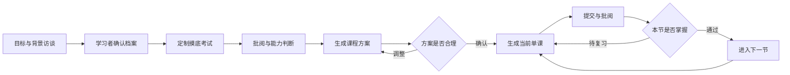

# sosplit/adaptive-learning-course（中文）

- 链接：https://github.com/sosplit/adaptive-learning-course
- 作者：sosplit
- 仓库说明：一个自适应学习 Skill。它通过背景访谈、定制摸底考试、课程方案确认和逐课练习，把“帮我学一个主题”变成可持续、有证据、有反馈的学习流程。
- 星数：4
- 获取方式：GitHub README + SKILL/说明文件

---

## README

# Adaptive Learning Course

一个基于 [Agent Skills 开放规范](https://agentskills.io/) 的自适应学习 Skill。它通过背景访谈、定制摸底考试、课程方案确认和逐课练习，把“帮我学一个主题”变成可持续、有证据、有反馈的学习流程。

## 特性

- **先了解再出题**：确认学习内容、目标、相关背景、时间约束和学习偏好后，才生成摸底考试。
- **针对性摸底**：根据目标和已有基础组合概念、理解、实作、纠错及任务拆解题。
- **课程方案共创**：基于访谈与摸底结果生成课程计划，必须经学习者确认后才开始授课。
- **按需生成单课**：每次只生成当前待学的一节，不提前批量生成整套试卷。
- **多种交付模式**：根据 Agent 能力选择本地网页、静态导出或纯对话体验。
- **本地答卷保存**：网页自动保存草稿，完整模式下由本地 Python 服务保存结构化 JSON。
- **对话式批阅**：逐题指出正确、部分正确和错误之处，更新完成、下一节和待复习状态。
- **可复用页面规范**：内置响应式 Demo、代码编辑器、视觉令牌和答卷协议。

## 工作流程



## 运行模式

Skill 会选择当前 Agent 环境能够支持的最完整模式。

| 模式 | 环境能力 | 学习与提交方式 |
|---|---|---|
| 完整本地网页 | 可读写文件、运行 Python，并能向学习者提供本地页面 | 启动本地服务，网页直接提交 JSON 答卷 |
| 静态导出 | 可创建文件，但无法提供可访问的本地服务 | 打开静态网页，导出 JSON 后交回 Agent |
| 纯对话 | 无法创建或交付文件 | 在对话中学习并显式提交结构化答案 |

无论使用哪种模式，都必须保留访谈确认、摸底、方案确认、逐课生成和基于答题证据更新进度这些阶段门禁。

## 安装

Skill 本身就是一个包含 `SKILL.md`、脚本、参考资料和页面资源的目录。推荐安装到跨工具通用位置：

```bash
mkdir -p ~/.agents/skills
git clone https://github.com/sosplit/adaptive-learning-course.git \
  ~/.agents/skills/adaptive-learning-course
```

也可以把整个目录放进项目中：

```text
<project>/.agents/skills/adaptive-learning-course/
```

常见 Agent 的发现目录如下。具体支持情况以对应工具版本和官方文档为准。

| Agent | 项目级目录 | 用户级目录 |
|---|---|---|
| 通用 Agent Skills | `.agents/skills/` | `~/.agents/skills/` |
| Codex | `.codex/skills/` | `~/.codex/skills/` |
| Cursor | `.agents/skills/` 或 `.cursor/skills/` | `~/.agents/skills/` 或 `~/.cursor/skills/` |
| Gemini CLI | `.agents/skills/` 或 `.gemini/skills/` | `~/.agents/skills/` 或 `~/.gemini/skills/` |
| Claude Code | `.claude/skills/` | `~/.claude/skills/` |
| GitHub Copilot | `.agents/skills/` 或 `.github/skills/` | `~/.agents/skills/` 或 `~/.copilot/skills/` |

安装后重新加载 Agent 会话或刷新 Skills 列表。

## 使用

可以直接对 Agent 说：

```text
使用 adaptive-learning-course 帮我设计并开始一套个性化学习流程。
```

支持 Agent Skills 自动发现的工具，也可以根据 `SKILL.md` 中的描述，在用户提出系统学习、能力摸底或继续课程时自动选择它。

首次使用时，Skill 不会立刻生成一套通用题库，而是分批询问：

- 想学习的主题和范围；
- 最终希望独立完成什么；
- 相关教育、工作、工具和项目背景；
- 当前能够独立完成哪些任务；
- 每周时间、截止日期及环境限制；
- 对讲解、练习、项目和反馈的偏好。

档案确认后才会生成摸底。完成摸底、确认课程方案后，可以通过“开始学习”或“继续学习”进入当前课程。

## 运行 Demo

脚手架会把可运行 Demo 复制到一个不存在的新目录，不会覆盖已有内容：

```bash
python3 scripts/scaffold_course.py /tmp/adaptive-course-demo
python3 /tmp/adaptive-course-demo/server.py
```

然后访问：

```text
http://127.0.0.1:4312/lesson/
```

端口冲突时可以指定其他端口：

```bash
python3 /tmp/adaptive-course-demo/server.py --port 4313
```

Demo 是一节完整的 Python 学习课，用于展示页面结构、随堂题、课末题、代码编辑器、草稿恢复和答卷提交。浏览器内的代码区是离线编辑器，不包含 Python 执行运行时。

## 目录结构

```text
adaptive-learning-course/
|-- SKILL.md                       通用 Skill 入口、阶段路由和运行模式
|-- references/
|   |-- workflow.md                访谈、摸底、方案和单课流程
|   |-- web-page-standard.md       页面视觉、交互与答卷规范
|   `-- artifacts-and-grading.md   文件组织、批阅与进度规则
|-- scripts/
|   `-- scaffold_course.py         课程 Demo 脚手架
`-- assets/course-demo/
    |-- server.py                  本地页面和答卷服务
    `-- lesson/index.html          可运行单课 Demo
```

## 页面与数据

完整本地网页模式下，答卷默认只保存在课程工作区的 `answers/` 目录，本项目不会主动上传到远程服务。静态导出模式由学习者把 JSON 答卷交回当前 Agent。正式课程页不应在 HTML、JavaScript 或提交 JSON 中包含答案和评分规则。

本地服务提供两个接口：

- `POST /api/diagnostic-answers`：保存摸底答卷。
- `POST /api/lesson-answers`：保存单课答卷。

详细协议见 [网页规范](references/web-page-standard.md) 和 [批阅规范](references/artifacts-and-grading.md)。

## 环境要求

- Skill 发现：支持 Agent Skills 规范，或能够手动读取 `SKILL.md`。
- 持久课程：Agent 能够读写学习者选择的工作区。
- 完整网页体验：Python 3.9 或更高版本，并允许启动本地进程。
- 静态导出体验：Agent 能创建或交付 HTML 文件。

Python 脚本不依赖第三方包。

## 贡献

欢迎提交 Issue 或 Pull Request。请让改动聚焦于自适应学习流程、页面模板、跨 Agent 兼容性或答卷机制，保留现有安全边界，并在提交前验证受影响的脚本和 Demo 行为。

## License

[MIT](LICENSE) © 2026 sosplit


## 文件 SKILL.md

---
name: adaptive-learning-course
description: Design and run personalized learning programs through background interviews, tailored diagnostics, user-approved course plans, on-demand lessons, saved exercises, and conversational grading. Use when a user asks to learn a subject systematically, assess their level, create a course, or continue an existing adaptive course.
license: MIT
metadata:
  author: zhurunfeng
  version: "1.1.0"
---

# Adaptive Learning Course

Build a course around evidence of what the learner can do, not only what they say they know. Keep one active stage at a time and preserve progress between turns.

## Route The Current Stage

Inspect the current workspace, when file access is available, for an existing learner profile, diagnostic answer, learning plan, lesson answer, and progress markers before acting. Otherwise, recover the current stage from the conversation and any artifacts the learner provides.

- No confirmed learner profile: read [references/workflow.md](references/workflow.md), then conduct the intake interview. Do not generate a diagnostic yet.
- Profile confirmed, no diagnostic completed: read the diagnostic section of [references/workflow.md](references/workflow.md), select a delivery mode, and generate the tailored diagnostic. Read [references/web-page-standard.md](references/web-page-standard.md) when using a web mode.
- Diagnostic submitted: read [references/artifacts-and-grading.md](references/artifacts-and-grading.md), grade it, create the proposed course plan, and ask the learner to confirm or revise the plan.
- Plan awaiting confirmation: discuss and apply requested changes. Do not start lesson generation until the learner accepts it.
- Confirmed plan and learner asks to start or continue: locate the current `[>]` lesson, then read the lesson section of [references/workflow.md](references/workflow.md). Read [references/web-page-standard.md](references/web-page-standard.md) when using a web mode. Generate only that lesson.
- Lesson answer submitted: read [references/artifacts-and-grading.md](references/artifacts-and-grading.md), grade it, explain errors, update progress, and close that lesson before offering the next one.

If the learner supplies some intake facts in the initial request, acknowledge them and ask only for material gaps. Never ask the learner to repeat information already available in the conversation or course artifacts.

## Required Gates

1. Confirm the subject, outcome, and relevant background before creating a diagnostic.
2. Use the diagnostic result, not the interview alone, to choose the course starting point.
3. Present the proposed plan and explicitly ask whether it is reasonable. Revise until accepted.
4. Generate each lesson on demand; do not pre-generate the full set of lesson exams.
5. Keep answer keys and grading rubrics out of learner-facing HTML and JSON.
6. Require submitted answers before grading. Save them as an answer artifact when file access is available; in conversational mode, treat the learner's explicit structured response as the submission. Do not infer completion from merely viewing a page or lesson.
7. After grading, mark the lesson `[x]`, `[R]`, or still in progress based on demonstrated mastery, then select the next `[>]` lesson.

## Select A Delivery Mode

Persistent courses require workspace file read/write access. Full local web mode additionally requires Python 3.9+ and permission to run a local process.

Before generating a diagnostic or lesson, choose the strongest mode supported by the current agent environment:

- Full local web mode: use when the agent can read and write workspace files, run Python 3.9+, and expose a local page the learner can open. Generate the webpage, start the bundled answer service, verify the URL, and grade the saved JSON submission.
- Static export mode: use when the agent can create files but cannot expose a reachable local service. Generate a standalone webpage with draft persistence and JSON export, give the learner the exact file or artifact location, and grade the returned JSON file.
- Conversational mode: use when the agent cannot create usable files. Present the same staged teaching and assessment directly in the conversation, collect explicit structured answers, and preserve course state in the conversation or any storage the environment provides.

Do not claim that a local URL is available until it has been started and verified. Read [references/workflow.md](references/workflow.md) for stage behavior and [references/web-page-standard.md](references/web-page-standard.md) for web-mode requirements.

## Web Artifacts

Use a local webpage for diagnostics and lessons when full local web or static export mode is available, unless the learner requests another format. Every webpage must save drafts in the browser and export structured JSON. Full local web mode additionally submits the same payload to the bundled local service.

For a new course workspace, run `scripts/scaffold_course.py <new-course-directory>` to copy the executable Demo and answer service. The command refuses to overwrite an existing path. Adapt the copied Demo to the selected subject and current stage; do not edit the installed skill asset in place.

The bundled Demo is under `assets/course-demo/`. It demonstrates the required visual language, responsive layout, question components, code editor behavior, local draft storage, and answer submission contract.

## Working Style

- Ask intake questions in small coherent batches rather than one exhaustive questionnaire.
- Make reasonable recommendations, but keep goals, pace, and plan negotiable with the learner.
- Match assessment methods to the subject: code editors for programming, calculations for quantitative topics, short analysis for conceptual topics, and practical scenarios where application matters.
- Explain grading in plain language. Distinguish knowledge gaps from typing, wording, or minor syntax slips.
- Preserve prior answers and reviews. Do not overwrite history when a resubmission needs comparison; use a new attempt record when the course workspace supports it.

